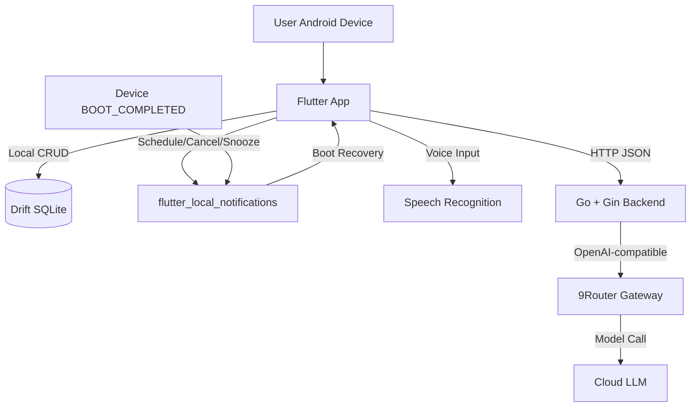
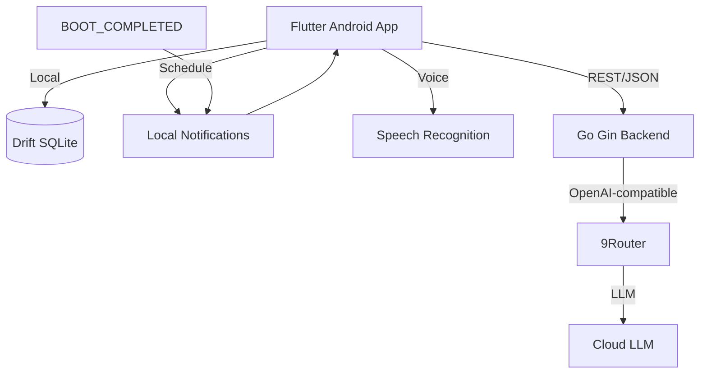
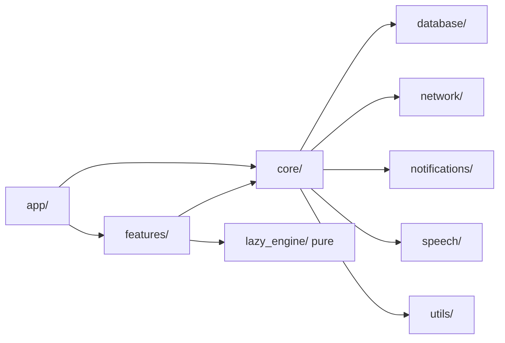
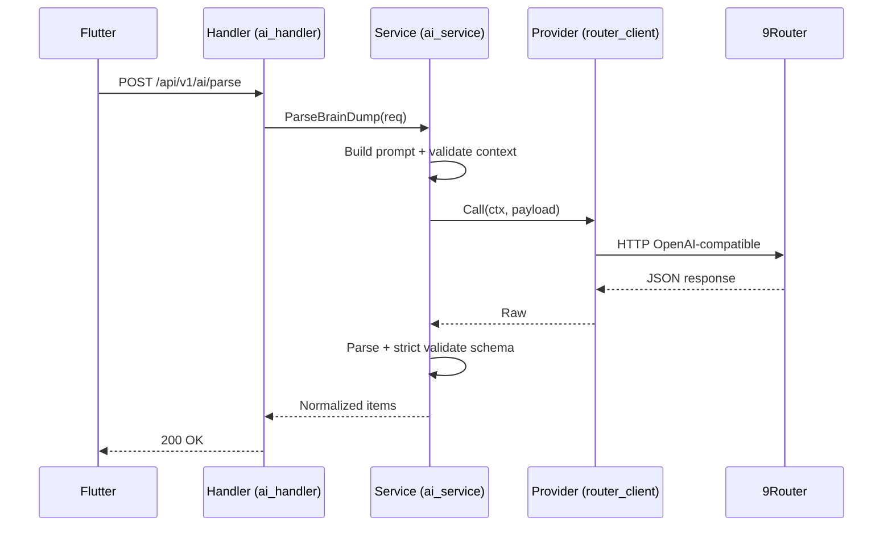
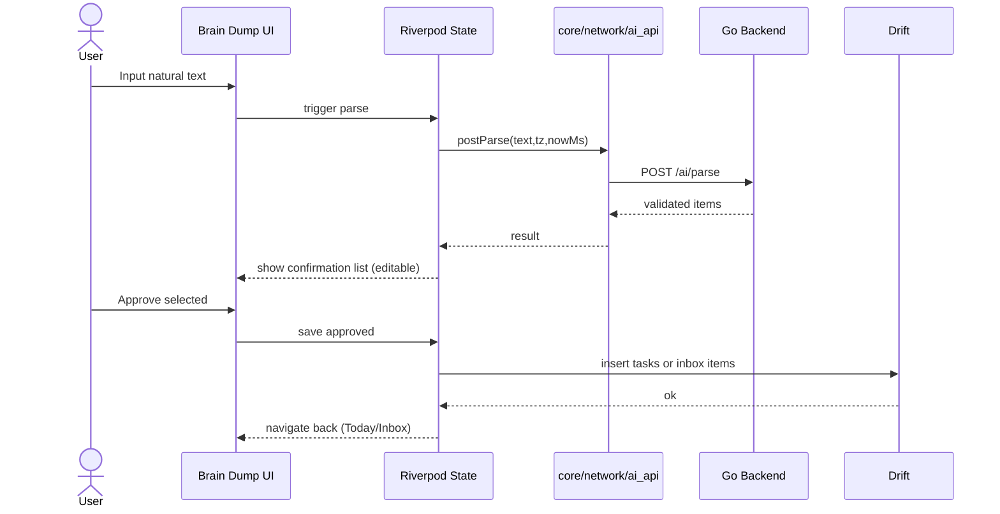
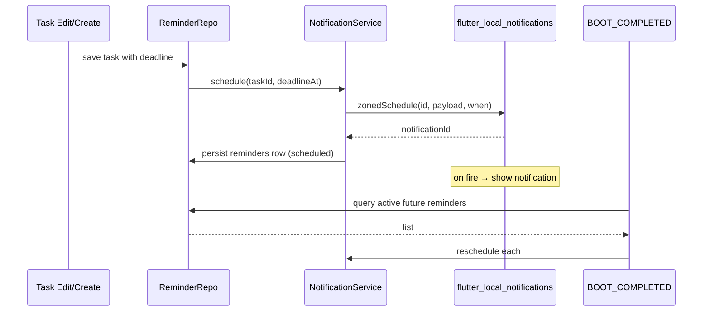
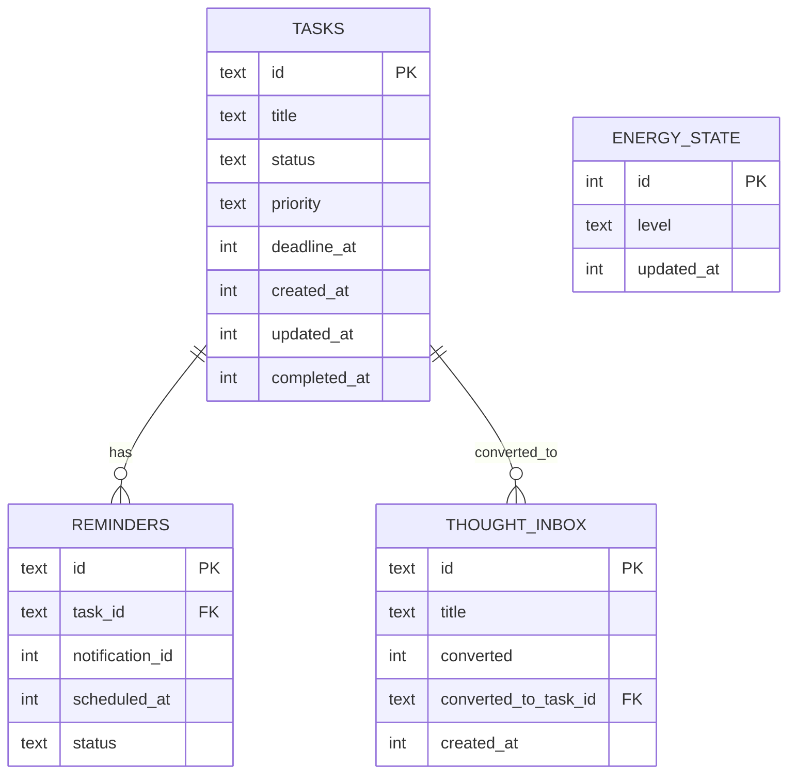

# ARCHITECTURE.md - LAZY Software Architecture

**Versi**: 1.0  
**Tanggal**: 2025-10-14  
**Status**: Draft - Implementation Ready  
**Berdasarkan**: PRD.md (Single Source of Truth)

---

## 1. Konteks Proyek

**Nama Produk**: LAZY  
**Tagline**: Less planning. More doing.  
**Platform**: Android-first  
**Tipe**: Single-user personal project

LAZY adalah aplikasi mobile personal productivity assistant yang mengurangi gesekan antara niat dan tindakan. Aplikasi ini menerapkan tiga prinsip arsitektur:

1. **Local-first by default** - Data inti disimpan dan dikelola secara lokal. AI bersifat opsional.
2. **AI-assisted, not AI-dependent** - Fitur core (task CRUD, Lazy Button, reminder, inbox) tetap berfungsi tanpa koneksi ke backend/AI.
3. **Simple modular architecture** - Pemisahan tanggung jawab yang jelas, hindari over-abstraction.

**Konsistensi dengan PRD**: Tidak ada konflik signifikan. Stack teknologi mengikuti PRD (Flutter+Riverpod+GoRouter+Drift, Go+Gin, 9Router). Perbedaan minor hanya pada penegasan detail implementatif.

---

## 2. Technology Stack yang Dikukuhkan

### Mobile (Flutter)
- **Flutter + Dart** - Cross-platform Android-first
- **Riverpod** - State management (reactive, testable, minimal boilerplate)
- **GoRouter** - Declarative navigation
- **Drift + SQLite** - Local persistence, type-safe queries
- **speech_to_text / native speech recognition** - Voice capture (via package yang stabil)
- **flutter_local_notifications** - Local reminders

### Backend (Go)
- **Golang** - Simpel, cepat, mudah untuk single-purpose service
- **Gin HTTP Framework** - Lightweight, routing jelas
- **net/http + http.Client** - HTTP transport
- **go-playground/validator/v10** - Request validation
- **log/slog** - Structured logging
- **testing + httptest** - Unit/integration tests

### AI
- **9Router** - Gateway LLM (OpenAI-compatible)
- **Backend-managed credentials** - API key hanya di env backend
- **Structured JSON extraction** + independent validation
- **Strict schema enforcement** di sisi backend

### Tooling
- **Git/GitHub**, **OpenCode** (AI coding agent), **Android-first**

---

## 3. Gaya Arsitektur

Diterapkan **Local-First Modular Architecture** dengan dua komponen utama.

### A. Flutter Mobile App
Bertanggung jawab atas:
- Presentation (UI widgets, screens)
- State management (Riverpod providers)
- Domain logic ringan (Lazy Engine scoring - pure function)
- Data layer (Drift DAOs/repos, local queries)
- Local notifications scheduling/cancel/snooze/recovery
- Voice capture & speech recognition
- Energy check-in
- Offline capability
- User confirmation untuk AI-generated items

### B. Go + Gin Backend
Bertanggung jawab atas **AI orchestration only**:
- HTTP handling & routing
- Request validation
- Prompt construction (controlled)
- 9Router client (OpenAI-compatible)
- Response parsing + strict schema validation
- Normalized error responses
- Timeout, retry policy (MVP: single attempt)
- Secure credential management

**Prinsip penting**: Mobile app tetap berfungsi tanpa backend. Backend tidak menyimpan task/inbox/energy/reminder. Hanya dipanggil saat user melakukan AI Brain Dump.

---

## 4.1 System Context Diagram



**Security Boundaries**:
- Credentials: hanya backend (.env)
- Network: HTTPS untuk backend↔9Router (dev boleh http lokal)
- Data: SQLite lokal; hanya `text`, `timezone`, `nowMs` dikirim ke AI

---

## 4.2 Arsitektur Flutter - Feature-First Modular

Menggunakan pendekatan **feature-first** dengan shared `core/`. Hindari layer-heavy (clean-arch berlebihan) untuk MVP solo-dev.

### Struktur Direktori

```text
mobile/
├── lib/
│   ├── app/
│   │   ├── app.dart                # MaterialApp + GoRouter + theme
│   │   ├── router.dart             # Route definitions
│   │   └── theme/                  # Theme tokens (colors/typography/spacing)
│   ├── core/
│   │   ├── config/                 # app config (api base, etc)
│   │   ├── constants/              # app constants
│   │   ├── database/               # Drift DB, tables, DAOs
│   │   ├── errors/                 # AppError types, failure mapping
│   │   ├── extensions/             # Dart extensions
│   │   ├── network/                # Dio client, API service (ai only)
│   │   ├── notifications/          # Notification service, boot handler
│   │   ├── speech/                 # Speech service wrapper
│   │   ├── utils/                  # helpers (date, uuid, validation)
│   │   └── widgets/                # shared UI components
│   ├── features/
│   │   ├── today/                  # Today dashboard + Lazy Button UI
│   │   ├── capture/                # Quick Capture
│   │   ├── braindump/              # AI Brain Dump input+confirmation
│   │   ├── tasks/                  # Task list/detail/edit
│   │   ├── inbox/                  # Thought Inbox + convert
│   │   ├── energy/                 # Energy check-in
│   │   ├── reminders/              # Reminder related UI (opsional)
│   │   └── lazy_engine/            # Pure scoring logic (domain)
│   └── main.dart
├── test/                           # unit/widget/integration
└── pubspec.yaml
```

### Organisasi per Feature

Setiap feature mengikuti pola minimal:
- `screens/` atau `ui/` - Widgets/screens
- `providers/` - Riverpod providers (state + actions)
- `repository/` - Data access abstraction over Drift (opsional tapi berguna). Untuk MVP, bisa langsung akses DAO/provider
- `models/` - Feature-specific view models (jika beda dari Drift data class)
- `widgets/` - Feature-local components

**Aturan**:
- `core/` hanya untuk shared cross-feature
- Hindari circular deps antar features
- `lazy_engine` berisi **pure functions** (no Flutter/Riverpod deps) untuk testability
- Prefer reuse via `core/widgets/` bukan duplikasi

---

## 4.3 Backend Architecture (Go + Gin)

Struktur modular sederhana, dependency direction: `handler → service → provider`. Tidak ada layer infra berlebihan.

```text
server/
├── cmd/
│   └── api/
│       └── main.go                 # entry point: load config, wire deps, start Gin
├── internal/
│   ├── config/
│   │   └── config.go               # env load (.env), defaults, validation
│   ├── handler/
│   │   └── ai_handler.go           # HTTP handlers, request bind/validate, response
│   ├── service/
│   │   └── ai_service.go           # orchestration: build prompt, validate schema, normalize
│   ├── provider/
│   │   └── router_client.go        # 9Router OpenAI-compatible client (http.Client)
│   ├── model/
│   │   ├── dto.go                  # request/response DTOs
│   │   └── schema.go               # AI JSON schema + validator
│   ├── middleware/
│   │   ├── logger.go               # slog middleware (minimal)
│   │   ├── timeout.go              # per-route timeout
│   │   └── recovery.go             # panic recovery
│   └── router/
│       └── router.go               # register routes, middleware
├── tests/                          # unit + httptest
├── go.mod
├── go.sum
└── .env.example
```

### Tanggung Jawab

| Komponen | Tanggung Jawab |
|---|---|
| **handler** | Bind JSON, basic validation, map service errors → HTTP status, return normalized JSON. Tidak ada business logic. |
| **service** | Build controlled system prompt (dengan timezone/now), call provider, parse+validate strict schema, normalize output. Business/orchestration logic. |
| **provider** | 9Router client: build request, set headers (Authorization: Bearer), timeout, handle HTTP errors. Abstracts gateway details. |
| **model** | DTOs, AI schema struct/tags, validation helpers. Shared contracts. |
| **middleware** | Logging (no PII), timeout, recovery, request size limit (opsional). |
| **config** | Load env: `AI_BASE_URL`, `AI_API_KEY`, `AI_MODEL`, `AI_TIMEOUT_SEC`, `PORT`, `LOG_LEVEL`. |

### Dependency Direction
`handler` depends on `service` interface (simple struct is fine; no DI framework). `service` depends on `provider` interface. All depend on `model`/`config`.

**Konstruksi eksplisit**: `NewX(deps...) *X` untuk wiring di `main.go`.

---

## 4.4 Data Architecture (Drift + SQLite)

### Konvensi Umum
- ID: `TEXT` dengan UUID v4 (generate lokal)
- Timestamp: `INTEGER` **unix milliseconds** (UTC ms). Untuk perhitungan lokal, konversi ke device tz saat render
- Soft delete vs Hard delete: **Hard delete** untuk MVP (kecuali ada kebutuhan audit). Reminder dengan FK `ON DELETE CASCADE`
- `created_at`, `updated_at` wajib (kecuali table singleton)
- Timezone: selalu pakai device timezone untuk interpretasi relative date & tampilan
- Normalisasi minimal; hindari tabel berlebihan

### Tabel: `tasks`
| Field | Type | Null | Default | Notes |
|---|---|---|---|---|
| id | TEXT | NO | PK (UUID) | |
| title | TEXT | NO | | trim, length 1–100 |
| description | TEXT | YES | | optional |
| status | TEXT | NO | 'pending' | CHECK('pending','in_progress','completed') |
| priority | TEXT | NO | 'medium' | CHECK('low','medium','high') |
| deadline_at | INTEGER | YES | | unix ms UTC |
| estimated_duration_min | INTEGER | YES | | 1–480 (reasonable) |
| energy_affinity | TEXT | YES | | CHECK('low','medium','high') |
| created_at | INTEGER | NO | | unix ms |
| updated_at | INTEGER | NO | | unix ms |
| completed_at | INTEGER | YES | | unix ms |

**Indexes**: `deadline_at`, `status`, `created_at`

### Tabel: `thought_inbox`
| Field | Type | Null | Default | Notes |
|---|---|---|---|---|
| id | TEXT | NO | PK | UUID |
| title | TEXT | NO | | |
| content | TEXT | YES | | original context (opsional) |
| created_at | INTEGER | NO | | |
| converted | INTEGER | NO | 0 | bool |
| converted_to_task_id | TEXT | YES | | FK tasks(id) ON DELETE SET NULL |

**Index**: `created_at`

### Tabel: `energy_state` (singleton)
| Field | Type | Null | Default | Notes |
|---|---|---|---|---|
| id | INTEGER | NO | 1 (PK) | enforce single row |
| level | TEXT | NO | 'medium' | CHECK('low','medium','high') |
| updated_at | INTEGER | NO | | unix ms |

### Tabel: `reminders`
| Field | Type | Null | Default | Notes |
|---|---|---|---|---|
| id | TEXT | NO | PK | UUID |
| task_id | TEXT | NO | | FK tasks(id) ON DELETE CASCADE |
| notification_id | INTEGER | NO | | platform ID |
| scheduled_at | INTEGER | NO | | unix ms |
| status | TEXT | NO | 'scheduled' | CHECK('scheduled','fired','cancelled','snoozed') |
| snooze_count | INTEGER | NO | 0 | |

**Indexes**: `task_id`, `scheduled_at`, `status`

### Drift Conventions
- Define tables in `core/database/tables/`
- Drift database class in `core/database/app_database.dart`
- DAOs in `core/database/daos/` (opsional) atau akses via database instance
- Migrations: minimal. Schema versioning via `schemaVersion`
- UUID: `uuid` package (`v4()`)
- Date utils terpusat (`core/utils/date_utils.dart`) - **pure functions**

---

## 4.5 API Contract

Backend hanya expose endpoint AI (minimal). Task CRUD tetap lokal.

### GET `/api/v1/health`
Health check.

**Response 200:**
```json
{ "status": "ok" }
```

### POST `/api/v1/ai/parse` (AI Brain Dump Extract)
Ekstrak multiple tasks dari natural language Bahasa Indonesia.

**Request:**
```json
{
  "text": "string",
  "timezone": "Asia/Jakarta",
  "nowMs": 1728900000000
}
```

**Validation:**
- `text`: min 3 chars, max 2000 chars (trim)
- `timezone`: valid IANA tz (e.g. `Asia/Jakarta`)
- `nowMs`: positive integer (unix ms)

**Response 200:**
```json
{
  "items": [
    {
      "title": "string",
      "suggestedDate": "YYYY-MM-DD|null",
      "suggestedTime": "HH:MM|null",
      "priority": "low|medium|high|null",
      "reason": "string|null"
    }
  ]
}
```

**Error Responses:**
| Status | Reason |
|---|---|
| 400 | Bad request (validation failed) |
| 408 | Request timeout |
| 422 | Invalid AI structured output (schema fail) |
| 502 | AI provider error/unavailable |
| 503 | Service unavailable/network |
| 500 | Internal server error |

**Error body (consistent):**
```json
{
  "error": { "code": "string", "message": "string", "details": {} }
}
```

**Notes**:
- Backend **tidak** menyimpan hasil. Hanya parse+validate
- `POST /api/v1/ai/briefing` di-skip untuk MVP (post-MVP per PRD)

---

## 4.6 AI Integration Architecture

### Pipeline Lengkap
1. **Input**: User ketik/parafrase di Brain Dump screen
2. **Client validate**: non-empty minimal
3. **Send**: POST `/api/v1/ai/parse` dengan `text`, `timezone` (device), `nowMs` (DateTime.now().millisecondsSinceEpoch)
4. **Backend validate**: request DTO + tz check
5. **Context build**: format `now` dalam tz user (e.g. `2025-10-14 14:30 Asia/Jakarta`) untuk prompt
6. **Prompt construct**: controlled system+user prompt (Bahasa Indonesia)
7. **Call 9Router**: OpenAI-compatible `chat/completions` (atau `responses`) dengan timeout
8. **Parse**: extract JSON only (strip markdown fences jika ada)
9. **Validate**: strict against schema (independent)
10. **Normalize**: trim, length limits, validate calendar date/time
11. **Return**: validated items
12. **Confirm UI**: Flutter tampil list editable, user approve/reject/edit
13. **Persist**: hanya item yang di-approve → save to Drift (tasks atau thought_inbox)

**Aturan kunci**: LLM **tidak pernah** langsung modify DB. User always in control.

### AI Output Contract Schema (Strict)

```json
{
  "type": "object",
  "required": ["items"],
  "properties": {
    "items": {
      "type": "array",
      "items": {
        "type": "object",
        "required": ["title"],
        "properties": {
          "title": {"type": "string", "minLength": 1, "maxLength": 100},
          "suggestedDate": {"type": ["string","null"], "pattern": "^\\d{4}-\\d{2}-\\d{2}$"},
          "suggestedTime": {"type": ["string","null"], "pattern": "^([01]\\d|2[0-3]):[0-5]\\d$"},
          "priority": {"type": ["string","null"], "enum": ["low","medium","high"]},
          "reason": {"type": ["string","null"]}
        }
      }
    }
  }
}
```

**Validasi tambahan:**
- `suggestedDate` valid calendar (no 2025-02-30)
- Parse JSON **only** - reject jika ada text lain
- Max items: 20
- Title trimmed
- Jika tidak ada date/time → **null** (bukan dipaksakan). Item ini akan diklasifikasikan sebagai **unscheduled** → masuk **Thought Inbox** saat disimpan (bukan task dengan deadline)

### Relative Date Handling (Bahasa Indonesia)
Backend prompt harus mengarahkan model untuk:
- Interpret: `hari ini`, `besok`, `lusa`, `minggu depan`, `bulan depan` (jarang), `senin depan`, `selasa`, dst
- Hitung relatif ke `now` + `timezone` yang dikirim client
- **Jangan menciptakan tanggal/deadline jika tidak disebut eksplisit**
- Untuk `kapan-kapan`, `nanti`, `entah kapan` → `suggestedDate/time = null`
- Jika ambigu → lebih baik null (user confirm)

**Catatan**: Validasi dilakukan backend-side. Model tidak di-trust 100%.

### Fallback Behavior
- Timeout (408) → UI: "Waktu tunggu habis. Coba lagi atau pakai Quick Capture."
- Provider error (502/503) → "Tidak bisa terhubung ke AI. Coba lagi nanti."
- Schema invalid (422) → "Hasil AI tidak sesuai format. Coba ubah kalimat atau pakai Quick Capture."
- Network error → graceful, no crash

### AI Provider Abstraction
Buat interface `AIProvider` di `provider/`:
```go
type AIProvider interface {
  ParseBrainDump(ctx context.Context, req ParseReq) (*ParseResp, error)
}
```

`RouterClient` implements interface. Jika nanti ganti model/provider, cukup ganti implementasi tanpa ubah `service`.

**Non-assumption**: Tidak semua model support JSON schema strict → kita **validasi mandiri** (json.Unmarshal + schema check).

---

## 4.7 9Router Connectivity

### Konfigurasi
Semua via environment variables (backend only).

`.env.example`:
```env
PORT=8080
AI_BASE_URL=http://localhost:3456/v1  # sesuaikan dengan 9Router local
AI_API_KEY=sk-xxx
AI_MODEL=deepseek-chat  # atau model terkonfigurasi
AI_TIMEOUT_SEC=12
LOG_LEVEL=info
```

### Development

- **9Router lokal**: bisa running di `localhost:3456` (atau port lain)
- **Go backend lokal**: `localhost:8080` (binding default)
- **Flutter app (emulator)**: `10.0.2.2:8080` untuk akses localhost laptop
- **Flutter app (physical device + LAN)**: pakai IP lokal laptop (e.g. `192.168.1.100:8080`)
- **Jangan** hardcode endpoint di Flutter. Simpan via `--dart-define` atau config file (dev only)

### Android Networking
Tambahkan `android/app/src/main/AndroidManifest.xml`:
```xml
<uses-permission android:name="android.permission.INTERNET" />
<application android:usesCleartextTraffic="true" ...> <!-- dev only -->
```

**Prod-like**: gunakan HTTPS + tidak expose 0.0.0.0 publik tanpa auth.

### Keamanan
- API key **hanya** di backend `.env` (gitignored)
- Never commit secrets
- CORS minimal (MVP: same-origin not strictly needed if app calls directly; or allow local dev)
- Request size limit (text max 2000)

---

## 4.8 Notification Architecture

Menggunakan `flutter_local_notifications`. DB (`reminders`) adalah **source of truth**.

### Alur Scheduling

1. User buat/edit task dengan `deadline_at` (ada waktu) → repo create/update task
2. Cancel existing reminder untuk task tsb (jika ada)
3. Schedule new notification via `NotificationService.scheduleTaskReminder(taskId, deadlineAt)`
4. Insert/update `reminders` row (notification_id, scheduled_at, status='scheduled')

### Actions

- **Schedule**: at `deadline_at` (exact/inexact sesuai Android API). Pertimbangkan `androidScheduleMode` (exact vs inexact)
- **Cancel**: `flutterLocalNotificationsPlugin.cancel(id)` + set status `cancelled`
- **Snooze**: cancel current, schedule new (e.g. +10 menit), increment `snooze_count`, new status `snoozed`
- **Complete/Delete task**: cancel notification
- **Fired**: update status `fired` (best effort)

### Boot Recovery (Device Restart)

- Android: register `RECEIVER_BOOT_COMPLETED`
- On boot: query `reminders` where `status in (scheduled,snoozed)` AND `scheduled_at > now`
- Reschedule via NotificationService
- Handle case where task already completed/deleted (filter)

### Android Constraints

- **Android 13+ (API 33)**: need `POST_NOTIFICATIONS` permission → request on demand dengan rationale singkat
- **Exact alarms**: `USE_EXACT_ALARM` / `SCHEDULE_EXACT_ALARM` considerations (Android 12+). Gunakan `inexact` jika exact tidak diizinkan
- **Doze mode/Adaptive Battery**: not guaranteed exact; dokumentasikan sebagai "best effort"
- **Battery optimization**: user bisa disable; MVP tidak force

### Duplicate Prevention
- Cek existing active reminder per task sebelum schedule
- Gunakan unique `notification_id` (bisa mapping dari reminder.id hash atau increment)

### Reconciliation
- UI hanya baca dari DB + plugin state minimal
- Source truth = `reminders` table + `tasks` status

---

## 4.9 Lazy Engine Architecture (Deterministic)

**Tujuan**: Rekomendasi **1 task** paling layak dikerjakan, **rule-based**, no LLM. Fully unit-testable (pure functions).

### Candidate Filtering
Kandidat = tasks dengan `status in (pending, in_progress)` DAN:
- deadline >= today? atau semua (handle overdue)
- exclude completed
- include unscheduled? (tasks tanpa deadline) — bisa masuk jika tidak ada yang urgent, tapi prioritas rendah

### Scoring Factors (Proposal MVP)

| Faktor | Bobot | Keterangan |
|---|---|---|
| **Urgency (deadline proximity)** | 0.40 | Semakin dekat deadline → skor naik. Overdue → boost signifikan |
| **Priority** | 0.20 | high=1.0, med=0.6, low=0.3 |
| **Energy compatibility** | 0.15 | match current energy → +bonus, mismatch → penalti ringan |
| **Age/idle** (created_at) | 0.10 | older pending → slight boost (avoid stale) |
| **Est duration fit** | 0.10 | cocok energi? (estimasi ringan) |
| **In-progress bonus** | +0.05 | prefer continue task yg sudah started |

**Normalization**: 0–1 range, total capped 1.0.

### Logic Details

- **Overdue**: `deadline_at < startOfToday` → urgency tinggi
- **Today**: sangat urgent
- **Tomorrow**: medium
- **>3 days**: lower
- **Unscheduled (no deadline)**: urgency minimal, rank di bawah scheduled kecuali semua scheduled jauh/completed
- **Energy**: jika `currentEnergy == task.energy_affinity` → +0.15 effect; else 0 (tidak force)
- **Tie-breaker**: smaller `deadline_at` → earlier first. If both unscheduled: older `created_at` first

### Implementation
- Pure function: `computeRecommendation(candidates, energy, now, tz) -> Recommendation?`
- Return: `{ taskId, reason: "string" }` (singkat, Bahasa Indonesia)
- `reason` contoh: "Deadline hari ini", "Energi cocok + prioritas tinggi", "Lanjutkan yang sudah dimulai"

### Empty State
Jika tidak ada kandidat → return null → UI "Semua tugas selesai. Tambah tugas baru atau istirahat."

**Testable**: semua input deterministik.

---

## 4.10 State Management (Riverpod)

Prinsip: **single source of truth** = SQLite. Riverpod jadi reactive bridge.

### Provider Categories

| Provider | Tipe | Kegunaan |
|---|---|---|
| `databaseProvider` | Provider | Drift DB instance (singleton) |
| `taskDaoProvider`/`taskRepoProvider` | Provider | Task data access |
| `inboxRepoProvider` | Provider | Thought Inbox |
| `energyRepoProvider` | Provider | Energy state |
| `reminderRepoProvider` | Provider | Reminders |
| `todayTasksProvider` | StreamProvider/ FutureProvider + watch | Reactive query (deadline today, pending) |
| `allPendingProvider` | StreamProvider | Untuk Lazy Engine |
| `energyStateProvider` | StreamProvider | Current energy level |
| `recommendationProvider` | Provider (computed) | Hasil Lazy Engine dari candidates+energy |
| `aiParseStateProvider` | StateNotifierProvider | Brain Dump parsing state (loading/error/result) |
| `quickCaptureProvider` | StateNotifierProvider (minimal) | Form state |
| `notificationServiceProvider` | Provider | NotificationService singleton |

### Patterns
- **Streams over Futures** untuk reactive UI (watch DB changes)
- **StateNotifier** untuk UI state (forms, loading flags)
- **Computed** via `Provider` untuk derived (recommendation)
- Avoid `ChangeNotifier` berlebihan
- Keep providers small & testable

### Rules
- SQLite authoritative
- Don't duplicate full task list in mutable state kecuali UI view
- Side-effects (schedule notification) di repo/service layer, dipanggil via provider action

---

## 4.11 Security & Privacy

| Area | Approach |
|---|---|
| **Credentials** | Backend-only (`.env`), gitignored, never in APK |
| **Data minimization** | Hanya `text`, `timezone`, `nowMs` ke AI. Tidak kirim full metadata sensitif |
| **Transport** | HTTPS untuk backend↔9Router (dev http lokal saja) |
| **Validation** | Request DTO + server-side. AI output strict schema validated |
| **Logging** | `slog` structured. **Jangan** log full user text. Truncate atau log length/status/latency |
| **Untrusted input** | AI output treated untrusted → re-validate, sanitize, user confirm |
| **Rate limiting** | MVP: minimal (single-user). Bisa tambahkan simple in-memory per IP jika public (tapi tidak disarankan) |
| **Request limits** | Text max 2000 chars, JSON body small |
| **Permissions** | POST_NOTIFICATIONS (Android 13+), RECORD_AUDIO (speech) — request on-demand |
| **No tracking** | No 3rd-party analytics/trackers untuk MVP |
| **Public exposure** | Jangan expose backend 0.0.0.0 ke internet tanpa auth. Personal use → LAN/localhost tunnel secukupnya |

**Note**: Single-user personal → auth optional. Jika dipublish, wajib tambahkan auth (out of MVP scope).

---

## 4.12 Error Handling & Offline Strategy

### Error Taxonomy (Go)
- `validation_error` (400)
- `timeout` (408)
- `ai_schema_invalid` (422)
- `provider_error` (502)
- `unavailable` (503)
- `internal` (500)

### Flutter Error Mapping
Consistent AppError sealed class: `NetworkError`, `TimeoutError`, `ValidationError`, `AiParseError`, `DatabaseError`, `PermissionError`.

### Behavior Matrix

| Scenario | Behavior |
|---|---|
| No internet (offline) | Task CRUD/LazyButton/Energy/Inbox/reminders: **OK**. AI Brain Dump: tampil pesan jelas, sarankan Quick Capture |
| Backend unavailable | AI Brain Dump: graceful fallback, tidak crash |
| 9Router timeout | 408 → UI pesan + retry optional |
| Invalid JSON/schema | 422 → minta ubah kalimat |
| Speech failure/perm denied | Fallback ke text input |
| DB error | Show user-friendly error, rollback transaksi |
| Notification perm denied | Tampilkan penjelasan ringan, tetap bisa pakai app |
| App killed mid-create | State lokal (unsaved) hilang? MVP: user input bisa transient; save on explicit Save/Confirm |
| Deadline in past | Allow dengan visual hint (user bisa log) |

**Core Principle**: AI-dependent features degrade gracefully. Core features work offline.

---

## 4.13 Testing Architecture

### Flutter
- **Unit**: Lazy Engine scoring, date utils (relative date), validators
- **Widget**: Today, Quick Capture, Brain Dump confirmation, Task Detail
- **Database**: Drift CRUD, migrations, FKs, cascade
- **Provider**: StateNotifier/StreamProvider behavior
- **Integration (minimal)**: Notification scheduling (mock)

### Go
- **Unit**: service (schema validation, prompt build), model validators
- **Handler**: httptest (status codes, errors)
- **Provider**: httptest mock 9Router responses (success + malformed + timeout)
- **Validation**: calendar date, schema edge cases

### AI Output Tests (Critical)
Test cases wajib:
- `"besok meeting jam 10"` → date tomorrow, time 10:00
- `"kerja project"` → both null (unscheduled)
- Mixed scheduled+unscheduled
- `"lusa"`, `"minggu depan"`, `"senin depan"`
- Invalid calendar `"2025-02-30"` → rejected (schema+extra validation)
- Markdown fence ` ```json {...} ``` ` → stripped

---

## 4.14 Performance Requirements (Realistic Targets)

| Metric | Target | Catatan |
|---|---|---|
| Cold start (Flutter) | < 2.0s | Debug acceptable; release optimize |
| Lazy Button compute | < 10ms | Pure, small dataset (dozens tasks) |
| DB ops (single CRUD) | < 50ms | SQLite lokal |
| AI request timeout | 10–15s (config) | Default 12s |
| Notification schedule | < 100ms | Single item |
| UI frame drops | 0 major | Avoid heavy build on main |
| Memory | Low | List kecil |

Targets ini bersifat **engineering target** (proposed), bukan benchmark terukur.

---

## 4.15 Architecture Decision Records (ADRs)

### ADR-001: Flutter sebagai Mobile Framework
- **Context**: Butuh Android-first cepat, single codebase, mature ecosystem
- **Decision**: Flutter + Dart
- **Alternatives**: Native Kotlin (more work), React Native (less native feel)
- **Consequences**: Good for MVP, stable. Overhead minimal

### ADR-002: Riverpod untuk State Management
- **Context**: Reactive, testable, compile-time safe, less boilerplate vs Bloc
- **Decision**: Riverpod
- **Alternatives**: Bloc, Provider, GetX (over-magic)
- **Consequences**: Fits feature-first, easy testing

### ADR-003: Drift + SQLite (Local-First)
- **Context**: Type-safe, migration support, Dart-native, offline essential
- **Decision**: Drift
- **Alternatives**: sqflite raw, floor, sembast (NoSQL)
- **Consequences**: Solid, SQL explicit

### ADR-004: Go + Gin Backend Hanya untuk AI
- **Context**: Core harus offline. AI butuh secure key + structured validation
- **Decision**: Thin backend (orchestration only). No server DB
- **Alternatives**: Call 9Router langsung dari app (expose key) → rejected
- **Consequences**: Secure, sederhana, menjaga local-first

### ADR-005: 9Router sebagai AI Gateway
- **Context**: OpenAI-compatible, fleksibel model, routing
- **Decision**: 9Router
- **Alternatives**: Langsung OpenAI/LLM vendor (lock-in, key exposure risk berbeda)
- **Consequences**: Abstraction bagus, provider-agnostic via interface

### ADR-006: Deterministic Lazy Button (Rule-Based)
- **Context**: Recurring, fast, testable, no cost, predictable
- **Decision**: Pure rule-based scoring
- **Alternatives**: LLM ranking (expensive, non-deterministic, latency)
- **Consequences**: Correct untuk MVP, explainable

### ADR-007: Tidak Ada Server-Side CRUD untuk MVP
- **Context**: Single-user, local-first, complexity
- **Decision**: All task/inbox/energy/reminder lokal
- **Alternatives**: Sync API (V2.0)
- **Consequences**: Simpler, offline-first, privacy

---

## 5. Required Diagrams

### 1) High-Level System Architecture


### 2) Flutter Module Dependency Diagram (Simplified)


### 3) Backend Request Flow


### 4) AI Brain Dump Sequence Diagram


### 5) Local Notification Lifecycle


### 6) Data Relationship Diagram


---

## 6. Architecture Constraints

- **Solo-dev friendly**: keep simple, minimal files
- **Local-first mandatory**: core offline-capable
- **AI optional**: graceful degradation
- **No microservices**: 2 components (app + thin backend)
- **No unnecessary infra**: avoid Redis/Postgres/Firebase/K8s
- **Deterministic over clever**: Lazy Button rule-based
- **Secure by default**: no keys in app
- **User in control**: AI results need confirmation
- **Testable**: pure functions for logic
- **Consistent with PRD**: stack & features aligned

---

## 7. Final Architecture Summary

- **Mobile**: Flutter + Riverpod + GoRouter + Drift → local-first, offline-capable
- **Backend**: Go + Gin → AI orchestration only, thin, secure
- **AI**: 9Router (OpenAI-compatible) + strict schema validation + fallback
- **Notifications**: flutter_local_notifications + boot recovery
- **Scoring**: Deterministic Lazy Engine (pure)
- **Data**: 4 core tables minimal
- **API**: 1 AI endpoint (`/api/v1/ai/parse`) + health

---

## 8. Confirmed Technology Stack

(Lihat section 2 - konsisten dengan PRD)

---

## 9. Important Technical Decisions

- Local-first > server-first (ADR-007)
- Backend only for AI (ADR-004) - prevents key exposure
- Deterministic Lazy Button (ADR-006) - correct untuk MVP
- Strict AI schema validation (4.6) - don't trust model
- Relative date interpret by client tz (4.6)
- DB = source of truth for reminders (4.8)
- Feature-first modular (4.2)

---

## 10. Known Architectural Risks

| Risk | Impact | Mitigasi |
|---|---|---|
| Android alarm/doze | Med | Gunakan appropriate schedule mode, dokumentasi best-effort |
| Emulator→localhost mapping | Med | Gunakan 10.0.2.2 / LAN IP, jelas di config |
| 9Router model variance (schema) | Med | Independent validation (bukan rely on response_format) |
| TZ change | Low | Gunakan device tz saat render/interpret |
| Boot recovery edge cases | Med | Unit-test query + reschedule logic |
| Speech API fragmentation | Low | Fallback ke text |

---

## 11. Unresolved Questions

1. **Speech package**: pakai `speech_to_text` vs `flutter_speech`? → evaluasi saat implement (both common). Recommendation: `speech_to_text` (lebih stabil)
2. **Exact alarm permission UX**: perlu explain dialog? MVP minimal
3. **CORS**: jika dev via LAN, perlu allow? Gin default fine
4. **Snooze duration**: 10 menit (fixed) atau configurable? MVP fixed 10m

Semua bisa diputuskan saat coding tanpa ubah core architecture.

---

## 12. Recommended Implementation Order

1. **M0**: Repo scaffolding (Flutter + Go), `.env.example`, linting
2. **M1**: Drift schema + tables + DAOs + migrations (core/database)
3. **M2**: Task CRUD UI + Today base
4. **M3**: Quick Capture + Thought Inbox (F01,F08)
5. **M4**: Lazy Engine (pure) + unit tests
6. **M5**: Energy Check-in + integrate ke Lazy Engine
7. **M6**: Notifications (schedule/cancel/snooze + boot)
8. **M7**: Go backend (config, handler/service/provider, validation)
9. **M8**: AI Brain Dump UI + confirmation + fallback
10. **M9**: Polish, QA, error states, permission flows

**Urutan ini konsisten dengan PRD milestones (M0–M9) dan meminimalkan dependencies.**

---

**End of ARCHITECTURE.md**
