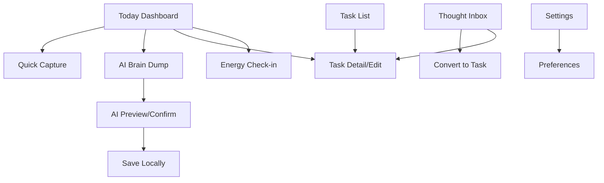

# DESIGN_SYSTEM.md - LAZY Design System & UX Specification

**Versi**: 1.0  
**Tanggal**: 2025-10-14  
**Status**: Draft - Implementation Ready  
**Berdasarkan**: PRD.md & ARCHITECTURE.md (Single Source of Truth)

---

## 1. Desain Filosofi

**Warm Minimalism + Playful Utility + Editorial Typography**

LAZY bertujuan mengurangi cognitive load saat capture, manage, dan decide next action. UI harus terasa:
- Tenang & ramah (warm & approachable)
- Minimal tanpa kosong (minimal without feeling empty)
- Fungsional tanpa kaku (functional without looking corporate)
- Playful tanpa kekanak-kanakan
- Berfokus pada 1 aksi utama per layar (one primary action)
- Bukan dashboard produktivitas yang padat

**Prinsip**: "Less UI, more action."

---

## 2. Visual Identity

- **Product**: LAZY
- **Tagline**: "Less planning. More doing."
- **Tone**: Friendly, concise, calm, slightly playful, non-judgemental, action-oriented
- **Platform**: Android-first
- **Foundation**: Material 3 (customized via tokens)

---

## 3. Color System

Berdasarkan PRD §6 - Design System.

### Base Palette
| Token | HEX | Usage |
|---|---|---|
| `warm-ivory` | `#F7F5EF` | Background base |
| `near-black` | `#20211F` | Ink/text primary |
| `butter-yellow` | `#F2D66D` | Accent/primary action |
| `soft-sage` | `#A9B9A0` | Subtle UI |
| `neutral-gray` | `#E7E5DF` | Surfaces/dividers |

### Semantic Tokens (Light Mode)
| Semantic | HEX | Notes |
|---|---|---|
| `bg` | `#F7F5EF` | App background |
| `surface` | `#FDFCFB` | Cards/sheets |
| `surface-elevated` | `#FFFFFF` | Inputs/high emphasis |
| `text-primary` | `#20211F` | Primary text |
| `text-secondary` | `#4A4B45` | Secondary text |
| `text-disabled` | `#8B8C87` | Disabled |
| `primary` | `#F2D66D` | CTAs |
| `on-primary` | `#20211F` | Text on yellow (high contrast) |
| `secondary` | `#A9B9A0` | Secondary actions/chips |
| `on-secondary` | `#20211F` | Text on sage |
| `accent` | `#F2D66D` | Highlights |
| `border` | `#E7E5DF` | Borders/dividers |
| `divider` | `#EDEBE7` | Subtle divider |
| `success` | `#6B8A5A` | Completed/status ok |
| `warning` | `#B9A06C` | Caution |
| `error` | `#D16B6B` | Destructive/error |
| `focus` | `#C9B05F` | Focus ring |
| `selected` | `#F5E7B8` | Selected state |
| `pressed` | `#E9D08A` | Pressed state |

**Accessibility**: Gunakan `on-primary=#20211F` di atas `primary=#F2D66D`. Hindari pakai yellow/sage untuk body text. Contrast target: >=4.5:1 untuk body, >=3:1 untuk large text.

**Dark mode**: Tidak diperlukan untuk MVP 1.0.

---

## 4. Typography System

### Typeface
- **Primary**: `Plus Jakarta Sans` (Recommended) – modern, playful yet readable
- **Alt**: `DM Sans` – softer alternative
- **Mono**: `JetBrains Mono` – hanya untuk metadata (timestamp/id) jika diperlukan

### Scale (mobile)
| Token | Size (px) | Weight | Line Height (em) | Letter Spacing (em) | Usage |
|---|---|---|---|---|---|
| `display` | 36 | 700 | 1.15 | -0.02 | Hero minimal (jarang) |
| `headline-lg` | 28 | 700 | 1.2 | -0.015 | Screen titles |
| `headline-md` | 24 | 600 | 1.25 | -0.01 | Section headers |
| `title-lg` | 20 | 600 | 1.3 | -0.01 | Card titles |
| `title-md` | 18 | 600 | 1.3 | 0 | List item titles |
| `body-lg` | 16 | 400 | 1.7 | 0 | Body text |
| `body-md` | 14 | 400 | 1.7 | 0 | Secondary body |
| `body-sm` | 12 | 400 | 1.6 | 0.01 | Captions/meta |
| `label-lg` | 14 | 600 | 1.5 | 0.01 | Button labels |
| `label-md` | 12 | 600 | 1.5 | 0.02 | Badges/chips |
| `caption` | 11 | 500 | 1.5 | 0.02 | Micro meta |

**Notes**: Support Android font scaling (use `TextScaler` aware). Hindari fixed-height containers.

---

## 5. Spacing, Layout & Radius

### 4-Point Spacing
| Token | px | Use |
|---|---|---|
| `xs` | 4 | Tight gaps |
| `sm` | 8 | Icon–text, chips |
| `md` | 12 | List items internal |
| `base` | 16 | Screen padding, card padding |
| `lg` | 20 | Sections |
| `xl` | 24 | Section gaps |
| `2xl` | 32 | Major sections |
| `3xl` | 40 | Spacing large |
| `4xl` | 48 | Bottom safe areas |

### Layout Defaults
- **Horizontal padding**: `16px` (base)
- **Vertical section**: `24px` (xl)
- **Card padding**: `16px` (base)
- **Keyboard-aware**: avoid bottom content hidden (use `SafeArea` + `viewInsets`)
- **Safe area bottom**: account for nav/gestures

### Border Radius
| Token | px | Use |
|---|---|---|
| `xs` | 4 | Badges, micro |
| `sm` | 8 | Chips, inputs |
| `md` | 12 | Cards |
| `lg` | 16 | Cards/BottomSheets |
| `xl` | 20 | Modals/large surfaces |
| `pill` | 999 | Buttons, tags |

### Elevation (Subtle)
| Token | Elev | Use |
|---|---|---|
| `none` | 0 | Flat (default) |
| `sm` | 1 | Subtle (pressed/active) – avoid heavy |
| `md` | 2 | Rare, avoid |

**Rule**: Flat-first. Hindari heavy shadows.

---

## 6. Component Library

### 6.1 LazyButton (Primary Recommendation)
- **Purpose**: CTA utama Today (rekomendasi 1 task)
- **Variant**: Primary (yellow)
- **Height**: 56–64px
- **Padding**: 16–20px horizontal, 14–16 vertical
- **Radius**: `pill` (999)
- **Bg**: `primary #F2D66D`, **Text**: `on-primary #20211F`
- **States**: Default, Hover/Pressed (`pressed #E9D08A`), Disabled (bg `#F5F5F5`, text `#8B8C87`)
- **Typography**: `label-lg` (14–16, 600)
- **Behavior**: Tap → call Lazy Engine, show reason, actions "Do it" / "Next"
- **Accessibility**: 48x48 min tap target, semantic "Recommend next task"

### 6.2 PrimaryButton
- Height 48–56px, radius pill, bg primary/on-primary, label-lg
- States default/pressed/disabled

### 6.3 SecondaryButton
- Outlined/tonal: bg transparent/border `border`, text `text-primary`, pressed subtle
- Radius pill, height 44–48

### 6.4 IconButton
- 48x48 min, radius pill, states subtle
- Accessibility: label required

### 6.5 RecommendedTaskCard
- **Purpose**: Tampilkan rekomendasi Lazy Button result
- Bg `surface #FDFCFB`, radius `md` 12, padding 16
- Title `title-md`, Reason `body-sm` (text-secondary), CTA inline
- Border subtle `border`

### 6.6 TaskCard
- Bg surface, radius md, padding 16, border `divider`
- Left: status/priority indicator, Body: title+meta, Right: actions
- States pressed subtle, completed: opacity 0.6, strikethrough title

### 6.7 QuickCaptureBar
- Bg `surface-elevated`, radius `lg`, padding 12–16, border `border`
- Hint "Tulis tugas atau ide...", Mic button prominent
- Auto-focus on open

### 6.8 VoiceCaptureButton
- Floating/icon: primary bg, 56x56, radius pill
- Recording: pulse/subtle (restraint), error state red
- States idle/recording/processing/error

### 6.9 EnergySelector
- Chips horizontal: Low/Med/High
- Selected: bg `selected`, border primary subtle, text `text-primary`
- Unselected: bg `surface`, border `border`
- Radius pill, height 40

### 6.10 PriorityIndicator
- Dot/chip: High (error), Med (warning), Low (sage)
- Small, non-color-only (label optional)

### 6.11 ReminderChip
- Small chip, bg `secondary` subtle, text `text-primary`, icon clock
- Radius pill

### 6.12 StatusBadge
- Pending/InProgress/Completed: semantic colors
- label-md, radius pill

### 6.13 EmptyState
- Illustration minimal (none preferred), icon subtle
- Title `title-md`, Body `body-md text-secondary`, CTA PrimaryButton
- Centered, generous padding

### 6.14 ErrorState
- Icon error, title+body, Retry CTA
- Non-blocking, Bahasa Indonesia friendly

### 6.15 LoadingIndicator
- CircularProgress (Material3), subtle color
- Sizes 24/36/48

### 6.16 ConfirmationBottomSheet
- Radius `xl` top, padding base+safe
- Title `title-lg`, Body `body-md`, Actions row (secondary + primary/destructive)
- For destructive: primary bg `error`, on-primary `#FFFFFF`

### 6.17 TaskPreviewCard (AI Extract)
- Bg surface, border `border`, radius md, padding 16
- Editable per item (title/date/time/priority), remove icon
- Highlight ambiguous (text-secondary), "Unscheduled" badge jika null

### 6.18 ThoughtInboxItem
- Card, title `title-md`, meta `body-sm text-secondary` (timestamp)
- Actions: Convert, Edit, Delete
- Unconverted state default

### 6.19 DateTimeSelector
- Material3 Date/Time pickers, themed (colorScheme primary)
- Compact, accessible

### 6.20 AppNavigationBar (Bottom)
- Destinations: Today, Inbox, Tasks, Settings (max 4)
- Active: label bold, indicator subtle
- Height 80+safe, hide on keyboard if disrupts

---

## 7. Information Architecture (IA)

Struktur navigasi sederhana sesuai PRD & ARCHITECTURE.

**Primary Destinations** (Bottom Nav): Today, Inbox, Tasks, Settings (max 4)

**Global Actions**: Quick Capture (FAB/bar), Lazy Button (Today), Voice Capture

**Routes (GoRouter)**: `/`, `/capture`, `/braindump`, `/task/:id`, `/inbox`, `/energy`, `/settings`



---

## 8. Screen-by-Screen UX Specification

### S01 - Splash/App Init
- Minimal: logo "LAZY" (typography only)
- Init DB, check permissions state
- Error: show retry, non-blocking
- No splash animation delay

### S02 - Today Dashboard
- Header: "Hari ini" + current date (e.g. "Senin, 14 Okt")
- Greeting ringan: "Mau mulai dari mana?"
- **Lazy Button** (primary) + reason
- Recommended card (jika tersedia)
- Sections: "Kegiatan hari ini", "Akan datang", "Selesai hari ini"
- Quick Capture FAB/bar
- Empty states tiap section
- Tap Lazy → "Do it" (mark in_progress) / "Next"

### S03 - Quick Capture
- TextField auto-focus, placeholder "Tulis tugas atau ide..."
- Voice icon, Clear
- Save/Cancel
- Keyboard-aware, minimal
- Empty → disable Save

### S04 - Voice Capture
- Mic visual state (idle/recording), subtle pulse saat recording
- Transcription live/editable
- Actions: Retry, Cancel, Use this text
- Permission: explain rationale, fallback text
- Speech error → friendly message

### S05 - AI Brain Dump
- Large TextArea placeholder "Ceritain aja semua yang mau kamu lakuin..."
- Hint: "AI bakal ekstrak jadi beberapa tugas. Bisa sebut tanggal/waktu kalau ada."
- CTA "Ekstrak dengan AI" (loading state)
- Fallback: "Pakai Quick Capture aja" on error

### S06 - AI Task Preview/Confirm
- List TaskPreviewCard per item (editable: title/date/time/priority, remove)
- Show "Unscheduled" if null
- Highlight ambiguous
- Actions: Kembali edit / Konfirmasi & Simpan
- Require confirmation before persist

### S07 - Task List
- Tabs/sections: Semua / Pending / InProgress / Completed
- TaskCard per item
- Empty state per tab
- Swipe? MVP minimal (tap detail)

### S08 - Task Detail/Edit
- Fields: Judul, Deskripsi (opsional), Prioritas, Deadline (tgl+waktu opsional), Est durasi (menit), Reminder toggle
- Actions: Simpan, Tandai Selesai, Hapus
- Destructive confirm for Hapus

### S09 - Thought Inbox
- ThoughtInboxItem list
- Empty: "Belum ada ide. Catat aja kapan aja."
- Convert opens Task form prefilled

### S10 - Energy Check-in
- Chips Low/Med/High
- Subtle: "Biar rekomendasi lebih pas sama tenaga kamu"
- Dismissible (tap outside / close)
- Persist immediately

### S11 - Settings
- Notifikasi (perm info)
- Info AI (backend status - opsional)
- Privasi (local-first)
- Tentang LAZY (version)

---

## 9. Pola Interaksi (Interaction Patterns)

- **Create Task**: Dari Today FAB / Quick Capture Bar → TextField auto-focus → enter/tap Save → optimistically persist ke SQLite → list terupdate via Riverpod stream.
- **Complete Task**: Tap checkbox/action pada TaskCard → animasi strike-through halus → status 'completed' → cancel reminder aktif.
- **Edit Task**: Tap TaskCard → buka Task Detail screen → modifikasi field → tap Simpan.
- **Delete Task**: Aksi destruktif → tampilkan modal konfirmasi minimal "Hapus kegiatan ini?" (Batal / Hapus). Jika disetujui → hapus dari SQLite + cancel notification.
- **Snooze Reminder**: Aksi notifikasi atau via detail → +10 menit → update DB reminder status 'snoozed'.
- **Voice Capture**: Tap VoiceCaptureButton → request permission mikrofon jika belum → status 'listening' dengan pulse halus → tampil live transcript → stop → review/edit teks → save / kirim ke AI.
- **AI Brain Dump**: Input bebas di textarea → tap 'Ekstrak dengan AI' → state loading dengan spinner subtle → response tampil di AI Task Preview/Confirm → user review/toggle/edit item → tap 'Konfirmasi & Simpan'.
- **Lazy Button**: Tap LazyButton di Today screen → deterministik engine evaluasi candidates (O(N), <10ms) → tampilkan RecommendedTaskCard dengan alasan singkat → user pilih "Kerjakan" (ubah status jadi in_progress) atau "Saran Lain".
- **Energy Check-in**: Bottom sheet / dialog ringan 3 opsi (Low / Medium / High) → tap langsung persist ke table `energy_state` → update reactive provider.
- **Convert Thought to Task**: Buka Thought Inbox → tap 'Jadikan Kegiatan' → navigasi ke Task Detail form prefilled judul & context → user isi tanggal/waktu (opsional) → simpan sebagai task aktif + tandai thought `converted=true`.

---

## 10. Motion & Microinteractions

Prinsip: Cepat, fungsional, hemat baterai, no decorative delays.

- **Button Press**: Scale down 0.98, duration 100ms, curve `Curves.easeInOut`.
- **Task Completion**: Checkbox checked + line-through fade-in 200ms + opacity 0.6.
- **Card Transition / Screen Push**: Standard Android predictive back / MaterialPageRoute (250–300ms).
- **Bottom Sheet Entrance**: Slide up with fade, duration 250ms, curve `Curves.easeOutCubic`.
- **Loading State**: Subtle indeterminate circular progress bar (Material 3).
- **Reduced Motion**: Hormati setting OS (`MediaQuery.of(context).disableAnimations` / `accessibleNavigation`). Jika aktif, set duration = 0ms.

---

## 11. UX Writing & Microcopy (Bahasa Indonesia)

Tone: Ramah, ringkas, tenang, tidak menghakimi (non-guilt-inducing), berorientasi aksi.

| Konteks | Contoh Baik (Digunakan) | Hindari |
|---|---|---|
| Empty Today | "Belum ada kegiatan hari ini. Mau catat sesuatu?" | "Daftar kosong! Anda belum merencanakan apapun." |
| Overdue Task | "Kegiatan ini belum sempat selesai. Mau dijadwal ulang?" | "Tugas terlambat / gagal!" |
| Task Selesai | "Bagus! Satu hal beres." | "Poin bertambah +10 XP!" |
| Lazy Button | "Mulai dari ini: [Judul Task]" | "AI merekomendasikan task terbaik untuk Anda." |
| AI Unavailable | "Tidak bisa terhubung ke AI. Kamu tetap bisa catat manual." | "Fatal Error 503: AI service connection failed." |
| Mic Permission | "LAZY perlu izin mikrofon untuk mencatat suaramu." | "Akses mikrofon ditolak." |
| Empty Inbox | "Kotak ide masih kosong. Ada ide liar yang mau disimpan?" | "Tidak ada data." |

---

## 12. Aksesibilitas (Accessibility)

- **Touch Target**: Minimal 48x48 dp untuk semua interactive elements (buttons, chips, icons).
- **Contrast**: Rasio kontras teks reguler minimal 4.5:1 terhadap background. Teks pada Butter Yellow (`#F2D66D`) wajib menggunakan Near Black (`#20211F`).
- **Font Scaling**: Gunakan `sp` / dynamic scaling. Jangan kunci tinggi container teks dengan nilai tetap (fixed height) yang memotong tulisan saat font size OS dibesarkan.
- **Screen Reader**: Pasang `Semantics` label pada icon-only buttons (misal: IconButton mikrofon diberi `label: 'Rekam suara'`).
- **Non-Color Indicators**: Status dan prioritas tidak hanya dibedakan lewat warna, melainkan juga teks/ikon (misal: label 'Tinggi', 'Sedang', 'Rendah').

---

## 13. Strategi Implementasi Flutter Design System

### Struktur Direktori Tema & Komponen

```text
mobile/lib/core/
├── theme/
│   ├── app_colors.dart         # Color tokens (#F7F5EF, #20211F, dll)
│   ├── app_typography.dart     # Plus Jakarta Sans text styles
│   ├── app_spacing.dart        # 4-pt grid tokens (xs: 4, sm: 8, base: 16, dll)
│   ├── app_radius.dart         # Border radius tokens (pill: 999, md: 12, dll)
│   └── app_theme.dart          # ThemeData (light) builder
└── widgets/
    ├── app_button.dart         # Primary, secondary, pill button
    ├── app_card.dart           # Base card container
    ├── empty_state_view.dart   # Reusable empty state
    ├── error_state_view.dart   # Reusable error view
    └── status_badge.dart       # Status & priority chip
```

- Komponen spesifik fitur (seperti `TaskCard`, `LazyButton`, `QuickCaptureBar`) ditempatkan di `features/<feature_name>/widgets/`.
- Gunakan `ThemeExtension` jika membutuhkan semantic tokens kustom di luar standard Material 3 `ColorScheme`.

---

## 14. Design QA Checklist

- [ ] Background menggunakan `#F7F5EF` secara konsisten.
- [ ] Tombol utama menggunakan `#F2D66D` dengan teks `#20211F`.
- [ ] Semua touch target interactive minimal 48x48 dp.
- [ ] Font Plus Jakarta Sans dirender proporsional tanpa clipping saat OS text scaling diubah ke 1.3x.
- [ ] Tidak ada glassmorphism, gradient berat, atau bayangan tebal.
- [ ] Microcopy konsisten dalam Bahasa Indonesia yang ramah dan tidak menghakimi.
- [ ] Empty state dan error state tersedia di setiap screen.

---

## 15. Catatan Keputusan Desain (Design ADRs)

1. **Light Mode First**: Mengingat MVP adalah personal Android project, prioritaskan light mode dengan palet Warm Ivory. Dark mode ditunda untuk efisiensi implementasi.
2. **Pill Buttons for Main CTAs**: Tombol utama berbentuk pill (radius 999) memberi kesan ramah dan playful sesuai identitas produk.
3. **No Decorative Gamification**: Tidak ada badge, streak, atau animasi konfeti yang memicu anxiety. Fokus pada kepuasan menyelesaikan aksi nyata.

---

**End of DESIGN_SYSTEM.md**

