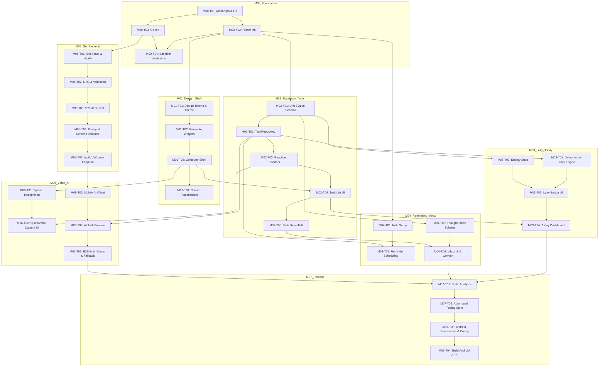

# IMPLEMENTATION_PLAN.md — LAZY Implementation Roadmap

**Versi**: 1.0  
**Tanggal**: 2025-10-16  
**Status**: Ready for Execution  
**Dokumen Referensi**: `docs/PRD.md`, `docs/ARCHITECTURE.md`, `docs/DESIGN_SYSTEM.md`

---

## 1. Strategi Pengembangan (Development Strategy)

Pengembangan LAZY menggunakan pendekatan **Vertical Slice Development** yang dipadukan dengan eksekusi berbasis milestone terstruktur (M00 hingga M07).
- Setiap task bersifat atomik, mandiri, dan dapat diverifikasi langsung melalui automated test atau perintah build konkret.
- Menerapkan prinsip **local-first**: fungsionalitas inti (manajemen tugas, Lazy Engine, penyimpanan lokal, notifikasi) dibangun dan diverifikasi secara independen sebelum integrasi jaringan cloud AI.
- Memegang prinsip **ponytail / lazy engineering**: tidak membuat abstraksi prematur, tidak menambahkan dependensi yang tidak diminta, dan mengutamakan implementasi minimal yang teruji.

---

## 2. Cakupan Teknis Terkonfirmasi (Confirmed Technical Scope)

- **Mobile**: Flutter 3.x + Dart, State Management via Riverpod, Routing via GoRouter, Local DB via Drift + SQLite, Speech Recognition via speech_to_text, Local Reminders via flutter_local_notifications.
- **Backend**: Golang 1.22+, Web Framework Gin, Validation via go-playground/validator/v10, Structured Logging via log/slog, Testing via Go std testing + httptest.
- **AI Gateway**: 9Router (OpenAI-compatible HTTP client), penanganan token/kredensial backend-only, validasi ketat format JSON ekstraksi.
- **Batasan MVP**: Tanpa multi-user, tanpa sinkronisasi cloud database, tanpa Redis/PostgreSQL/Firebase.

---

## 3. Ringkasan Milestone (Milestone Overview)

- **M00 — Project Foundation**: Inisialisasi monorepo (`mobile/` & `server/`), gitignore, env config, dan verifikasi toolchain build.
- **M01 — Design System & App Shell**: Implementasi tema Flutter (warna, tipografi, spacing, komponen dasar), GoRouter shell, dan navigasi utama.
- **M02 — Local Database & Task Management**: Setup Drift DB, skema tasks, TaskRepository, reactive state Riverpod, dan CRUD UI screen.
- **M03 — Today Dashboard & Lazy Engine**: Algoritma deterministik Lazy Button, integrasi Energy Check-in, Today Dashboard UI.
- **M04 — Reminder System & Thought Inbox**: Notifikasi lokal Android, snooze, restart recovery, skema dan UI Thought Inbox.
- **M05 — Go Backend & 9Router Integration**: Server Gin, konfigurasi env, client 9Router, prompt builder, dan endpoint `/api/v1/ai/parse` dengan validasi schema ketat.
- **M06 — Voice Capture & AI Brain Dump**: Integrasi speech-to-text di mobile, koneksi HTTP client ke backend, alur preview konfirmasi ekstraksi AI.
- **M07 — QA, Optimization & Android Release**: Pengujian E2E, audit aksesibilitas, static analysis, dan build APK rilis Android.

---

## 4. Master Task Index

| Task ID | Nama Task | Milestone | Prioritas | Dependensi | Status |
|---|---|---|---|---|---|
| M00-T01 | Inisialisasi Monorepo & Konfigurasi Git | M00 | Must Have | - | DONE |
| M00-T02 | Inisialisasi Proyek Flutter Mobile | M00 | Must Have | M00-T01 | DONE |
| M00-T03 | Inisialisasi Modul Go Backend | M00 | Must Have | M00-T01 | DONE |
| M00-T04 | Setup Environment & Verifikasi Build Baseline | M00 | Must Have | M00-T02, M00-T03 | DONE |
| M01-T01 | Implementasi Design Tokens & Theme Flutter | M01 | Must Have | M00-T02 | DONE |
| M01-T02 | Implementasi Komponen Dasar Reusable | M01 | Must Have | M01-T01 | DONE |
| M01-T03 | Setup Navigasi GoRouter & Bottom Navigation Shell | M01 | Must Have | M01-T02 | DONE |
| M01-T04 | Placeholder Screens & Widget Testing Shell | M01 | Must Have | M01-T03 | DONE |
| M02-T01 | Setup Drift SQLite Database & Skema Tasks | M02 | Must Have | M00-T02 | DONE |
| M02-T02 | Implementasi TaskRepository & Unit Tests | M02 | Must Have | M02-T01 | DONE |
| M02-T03 | Implementasi Reactive Task Riverpod Providers | M02 | Must Have | M02-T02 | DONE |
| M02-T04 | Implementasi UI Task List & Status Toggle | M02 | Must Have | M01-T03, M02-T03 | DONE |
| M02-T05 | Implementasi UI Task Detail, Edit & Delete | M02 | Must Have | M02-T04 | DONE |
| M03-T01 | Implementasi Deterministic Lazy Engine (Scoring Logic) | M03 | Must Have | M02-T02 | DONE |
| M03-T02 | Implementasi Skema & Fitur Energy Check-in | M03 | Should Have | M02-T01 | DONE |
| M03-T03 | Implementasi RecommendedTaskCard & Lazy Button UI | M03 | Must Have | M03-T01, M03-T02 | DONE |
| M03-T04 | Integrasi Today Dashboard Screen | M03 | Must Have | M03-T03, M02-T04 | DONE |
| M04-T01 | Setup flutter_local_notifications & Permission Handler | M04 | Must Have | M00-T02 | DONE |
| M04-T02 | Implementasi Reminder Service, Scheduling & Snooze | M04 | Must Have | M04-T01, M02-T02 | DONE |
| M04-T03 | Implementasi Skema Drift & Repository Thought Inbox | M04 | Must Have | M02-T01 | DONE |
| M04-T04 | Implementasi UI Thought Inbox & Konversi ke Task | M04 | Must Have | M04-T03, M02-T05 | DONE |
| M05-T01 | Setup Gin Web Server, Config & Logging | M05 | Must Have | M00-T03 | DONE |
| M05-T02 | Implementasi DTO, Validation & Error Taxonomy | M05 | Must Have | M05-T01 | DONE |
| M05-T03 | Implementasi 9Router OpenAI-Compatible Client | M05 | Must Have | M05-T02 | DONE |
| M05-T04 | Implementasi Prompt Builder & Schema Extraction Validator | M05 | Must Have | M05-T03 | DONE |
| M05-T05 | Implementasi Endpoint `/api/v1/ai/parse` & Handler Tests | M05 | Must Have | M05-T04 | DONE |
| M06-T01 | Integrasi Speech-to-Text & Permission Audio Mobile | M06 | Must Have | M01-T03 | DONE |
| M06-T02 | Implementasi Quick Capture & Voice Capture UI | M06 | Must Have | M06-T01, M02-T03 | DONE |
| M06-T03 | Implementasi Mobile HTTP Client untuk Backend AI | M06 | Must Have | M05-T05 | DONE |
| M06-T04 | Implementasi UI AI Task Preview & Confirmation Screen | M06 | Must Have | M06-T03, M02-T02 | DONE |
| M06-T05 | Integrasi End-to-End AI Brain Dump & Offline Fallback | M06 | Must Have | M06-T04 | DONE |
| M07-T01 | Verifikasi Static Analysis, Format & Linting Seluruh Proyek | M07 | Must Have | M01 s/d M06 | DONE |
| M07-T02 | Automated Unit & Integration Testing Suite | M07 | Must Have | M07-T01 | DONE |
| M07-T03 | Konfigurasi Android Permissions & Release Signing Setup | M07 | Must Have | M07-T02 | DONE |
| M07-T04 | Verifikasi Build Android APK Release & Release Notes | M07 | Must Have | M07-T03 | DONE |

---

## 5. Rincian Task Atomik (Detailed Atomic Tasks)

### [M00-T01] — Inisialisasi Monorepo & Konfigurasi Git
**Milestone:** M00  
**Priority:** Must Have  
**Dependencies:** None  
**Objective:** Menyiapkan struktur direktori root monorepo, konfigurasi gitignore komprehensif, dan lisensi/dokumentasi repositori.  
**Scope:**
- Membuat file `.gitignore` mencakup Flutter, Dart, Go, IDE (VSCode/Android Studio), file `.env`, file build artifacts.
- Verifikasi keberadaan direktori `mobile/` dan `server/`.
**Out of Scope:** Inisialisasi file source code aplikasi.  
**Expected Files / Modules:** `.gitignore`, `README.MD`  
**Implementation Steps:**
1. Perbarui `.gitignore` di root repositori dengan pola standar Flutter + Go + binary + env.
2. Pastikan subdirektori `mobile/` dan `server/` siap digunakan.
**Acceptance Criteria:**
- File `.gitignore` ada dan mengabaikan `.env`, `*.log`, build/ artifacts, vendor, dan cache tools.
- Direktori `mobile/` dan `server/` bersih dan terstruktur.
**Testing Requirements:** Inspeksi git status memastikan file build/rahasia diabaikan.  
**Verification Commands:**
```bash
git status
```
**Definition of Done:** `.gitignore` terkonfigurasi, git tracking bersih.  
**Suggested Commit Message:** `chore: initialize monorepo structure and gitignore`

---

### [M00-T02] — Inisialisasi Proyek Flutter Mobile
**Milestone:** M00  
**Priority:** Must Have  
**Dependencies:** M00-T01  
**Objective:** Menginisialisasi proyek Flutter di direktori `mobile/` dengan package id `com.lazy.app` dan dependensi dasar MVP.  
**Scope:**
- Menjalankan `flutter create --org com.lazy --project-name lazy_app mobile` atau setup `pubspec.yaml` sesuai standar Flutter.
- Menambahkan dependensi awal: `flutter_riverpod`, `go_router`, `drift`, `sqlite3_flutter_libs`, `path_provider`, `path`, `flutter_local_notifications`, `speech_to_text`, `dio`, `intl`, `uuid`.
- Menambahkan dev_dependencies: `drift_dev`, `build_runner`, `flutter_test`, `flutter_lints`, `mocktail`.
**Out of Scope:** Mengembangkan logic atau antarmuka aplikasi.  
**Expected Files / Modules:** `mobile/pubspec.yaml`, `mobile/lib/main.dart`  
**Implementation Steps:**
1. Masuk ke `mobile/`, jalankan pembuatan proyek Flutter Android-first jika belum ada, atau sesuaikan file konfigurasi proyek.
2. Tambahkan paket-paket terkonfirmasi ke `mobile/pubspec.yaml`.
3. Jalankan `flutter pub get`.
**Acceptance Criteria:**
- `pubspec.yaml` memuat seluruh pustaka yang disepakati tanpa dependency conflict.
- Perintah `flutter pub get` berhasil dengan exit code 0.
**Testing Requirements:** `flutter pub get`  
**Verification Commands:**
```bash
cd mobile && flutter pub get
```
**Definition of Done:** Proyek Flutter valid dan dapat di-compile/analisis tanpa error dependensi.  
**Suggested Commit Message:** `chore: initialize flutter project and configure dependencies`

---

### [M00-T03] — Inisialisasi Modul Go Backend
**Milestone:** M00  
**Priority:** Must Have  
**Dependencies:** M00-T01  
**Objective:** Menginisialisasi modul Go pada direktori `server/` dan menambahkan dependensi Gin & validator.  
**Scope:**
- Inisialisasi `go mod init server` atau nama modul yang disepakati (`lazy/server`).
- Menambahkan dependensi: `github.com/gin-gonic/gin`, `github.com/go-playground/validator/v10`, `github.com/joho/godotenv`.
- Menyiapkan struktur direktori: `cmd/api/`, `internal/config/`, `internal/handler/`, `internal/service/`, `internal/provider/`, `internal/model/`, `internal/middleware/`, `internal/router/`.
- Menyediakan file `.env.example`.
**Out of Scope:** Implementasi logic handler dan koneksi 9Router.  
**Expected Files / Modules:** `server/go.mod`, `server/go.sum`, `server/.env.example`, `server/cmd/api/main.go` (baseline minimal)  
**Implementation Steps:**
1. Masuk ke `server/`, buat modul go `lazy/server`.
2. Unduh pustaka yang diperlukan (`gin`, `validator`, `godotenv`).
3. Buat file `.env.example` dengan variabel: `PORT=8080`, `AI_BASE_URL=http://localhost:3456/v1`, `AI_API_KEY=`, `AI_MODEL=deepseek-chat`, `AI_TIMEOUT_SEC=12`, `LOG_LEVEL=info`.
4. Buat file `server/cmd/api/main.go` minimal yang hanya mencetak log inisialisasi.
**Acceptance Criteria:**
- `go mod tidy` selesai tanpa error.
- Direktori internal backend terbentuk sesuai ARCHITECTURE.md.
**Testing Requirements:** `go build ./cmd/api`  
**Verification Commands:**
```bash
cd server && go mod tidy && go build -o /dev/null ./cmd/api
```
**Definition of Done:** Modul Go terkompilasi dan file `.env.example` tersedia.  
**Suggested Commit Message:** `chore: initialize go backend module and directory structure`

---

### [M00-T04] — Setup Environment & Verifikasi Build Baseline
**Milestone:** M00  
**Priority:** Must Have  
**Dependencies:** M00-T02, M00-T03  
**Objective:** Memastikan environment monorepo siap dieksekusi secara independen.  
**Scope:**
- Verifikasi `flutter analyze` pada template awal mobile.
- Verifikasi `go vet ./...` pada template awal server.
**Out of Scope:** Menulis test fitur aplikasi.  
**Expected Files / Modules:** `mobile/`, `server/`  
**Implementation Steps:**
1. Jalankan analyzer pada proyek Flutter.
2. Jalankan vet pada proyek Go.
**Acceptance Criteria:**
- Tidak ada issue fatal pada static analysis kedua sub-project.
**Testing Requirements:** `flutter analyze` dan `go vet ./...`  
**Verification Commands:**
```bash
cd mobile && flutter analyze
cd ../server && go vet ./...
```
**Definition of Done:** Verifikasi baseline lulus 100%.  
**Suggested Commit Message:** `chore: verify baseline builds for mobile and server`

---

### [M01-T01] — Implementasi Design Tokens & Theme Flutter
**Milestone:** M01  
**Priority:** Must Have  
**Dependencies:** M00-T02  
**Objective:** Mengonfigurasi warna, tipografi, spacing, dan ThemeData kustom sesuai `DESIGN_SYSTEM.md`.  
**Scope:**
- `mobile/lib/core/theme/app_colors.dart` (Warm Ivory #F7F5EF, Near Black #20211F, Butter Yellow #F2D66D, Soft Sage #A9B9A0, Neutral Gray #E7E5DF, Semantic colors).
- `mobile/lib/core/theme/app_typography.dart` (Display, Headline, Title, Body, Label dengan fallback sans-serif).
- `mobile/lib/core/theme/app_spacing.dart` (4-pt scale: 4, 8, 12, 16, 20, 24, 32, 40, 48).
- `mobile/lib/core/theme/app_radius.dart` (xs: 4, sm: 8, md: 12, lg: 16, xl: 20, pill: 999).
- `mobile/lib/core/theme/app_theme.dart` (Light Material 3 ThemeData).
**Out of Scope:** Dark theme, custom widget implementation.  
**Expected Files / Modules:** `mobile/lib/core/theme/*`  
**Implementation Steps:**
1. Definisikan konstanta warna dan token semantik di `app_colors.dart`.
2. Definisikan text styles di `app_typography.dart`.
3. Definisikan spacing dan radius di file terpisah.
4. Buat builder `AppTheme.lightTheme` yang mengonfigurasi `scaffoldBackgroundColor`, `colorScheme`, `textTheme`, `appBarTheme`.
**Acceptance Criteria:**
- Warna background scaffold adalah `#F7F5EF`.
- Warna primary adalah `#F2D66D` dengan text `#20211F`.
- Nilai kontras mematuhi WCAG AA untuk teks standar.
**Testing Requirements:** Unit test memverifikasi nilai token tema.  
**Verification Commands:**
```bash
cd mobile && flutter test test/core/theme/theme_test.dart
```
**Definition of Done:** Token tema lengkap dan unit test tema lulus.  
**Suggested Commit Message:** `feat(mobile): implement design tokens and theme configuration`

---

### [M01-T02] — Implementasi Komponen Dasar Reusable
**Milestone:** M01  
**Priority:** Must Have  
**Dependencies:** M01-T01  
**Objective:** Membuat komponen antarmuka umum sesuai DESIGN_SYSTEM.md §6.  
**Scope:**
- `AppButton` (Primary yellow pill button & secondary outlined button).
- `AppCard` (Container bersudut 12px dengan background surface `#FDFCFB`).
- `StatusBadge` (Chip status task).
- `EmptyStateView` & `ErrorStateView`.
**Out of Scope:** Komponen kompleks per-fitur (LazyButton, TaskCard).  
**Expected Files / Modules:** `mobile/lib/core/widgets/*`  
**Implementation Steps:**
1. Buat `AppButton` dengan handling tap state dan minimum touch target 48x48.
2. Buat `AppCard` dengan border subtle dan flat elevation.
3. Buat `EmptyStateView` dengan pesan ramah non-judgemental.
4. Buat widget tests untuk masing-masing komponen dasar.
**Acceptance Criteria:**
- Komponen mematuhi touch target minimal 48x48.
- Render warna dan border sesuai token.
**Testing Requirements:** Widget test untuk `AppButton` dan `AppCard`.  
**Verification Commands:**
```bash
cd mobile && flutter test test/core/widgets/
```
**Definition of Done:** Komponen teruji melalui widget tests.  
**Suggested Commit Message:** `feat(mobile): implement core reusable ui components`

---

### [M01-T03] — Setup Navigasi GoRouter & Bottom Navigation Shell
**Milestone:** M01  
**Priority:** Must Have  
**Dependencies:** M01-T02  
**Objective:** Mengonfigurasi GoRouter dengan StatefulShellRoute untuk navigasi bawah (Today, Inbox, Tasks, Settings).  
**Scope:**
- `mobile/lib/app/router.dart`: Rute `/` (Today), `/inbox` (Thought Inbox), `/tasks` (All Tasks), `/settings` (Settings), serta rute modal `/capture`, `/braindump`, `/task/:id`.
- `mobile/lib/app/app.dart`: `MaterialApp.router` yang mengikat Riverpod dan GoRouter.
- Bottom navigation bar dengan 4 destinasi utama.
**Out of Scope:** Integrasi logic database di dalam screen.  
**Expected Files / Modules:** `mobile/lib/app/router.dart`, `mobile/lib/app/app.dart`  
**Implementation Steps:**
1. Definisikan `GoRouter` dengan rute yang sesuai ARCHITECTURE.md.
2. Buat widget scaffold utama dengan `NavigationBar` Material 3 yang dikustomisasi.
3. Hubungkan router ke `MaterialApp.router`.
**Acceptance Criteria:**
- Navigasi antar tab berfungsi mulus tanpa me-recreate state tab secara tidak perlu.
- Deep-link rute `/tasks` dan `/inbox` dapat di-resolve.
**Testing Requirements:** Widget test navigasi tab via tester.  
**Verification Commands:**
```bash
cd mobile && flutter test test/app/router_test.dart
```
**Definition of Done:** Shell navigasi berjalan dan dites.  
**Suggested Commit Message:** `feat(mobile): configure gorouter and app navigation shell`

---

### [M01-T04] — Placeholder Screens & Widget Testing Shell
**Milestone:** M01  
**Priority:** Must Have  
**Dependencies:** M01-T03  
**Objective:** Menyediakan screen placeholder untuk semua rute utama sehingga aplikasi dapat dijalankan end-to-end tanpa error 404.  
**Scope:**
- `TodayScreen`, `InboxScreen`, `TasksScreen`, `SettingsScreen`, `QuickCaptureScreen`, `BrainDumpScreen`.
- Masing-masing menampilkan judul rute dan placeholder visual sesuai tema.
**Out of Scope:** Fitur CRUD dan AI.  
**Expected Files / Modules:** `mobile/lib/features/*/screens/*`  
**Implementation Steps:**
1. Buat file screen placeholder di masing-masing direktori feature.
2. Hubungkan ke rute di `router.dart`.
3. Buat widget test untuk memverifikasi semua rute dapat di-render.
**Acceptance Criteria:**
- Aplikasi dapat di-launch dan user dapat berpindah antar semua 4 tab tanpa crash.
**Testing Requirements:** `flutter test test/features/shell_smoke_test.dart`  
**Verification Commands:**
```bash
cd mobile && flutter test
```
**Definition of Done:** Smoke test navigasi lulus.  
**Suggested Commit Message:** `feat(mobile): add screen placeholders and navigation smoke tests`

---

### [M02-T01] — Setup Drift SQLite Database & Skema Tasks
**Milestone:** M02  
**Priority:** Must Have  
**Dependencies:** M00-T02  
**Objective:** Mengonfigurasi Drift database dan membuat tabel `tasks` sesuai ARCHITECTURE.md §4.4.  
**Scope:**
- `mobile/lib/core/database/tables/tasks_table.dart` (id UUID, title, description, status, priority, deadline_at, estimated_duration_min, energy_affinity, created_at, updated_at, completed_at).
- `mobile/lib/core/database/app_database.dart` dengan Drift executor SQLite di Android/iOS/desktop.
- Generate file `app_database.g.dart` menggunakan `build_runner`.
**Out of Scope:** Tabel reminders dan inbox (dibuat di milestone terkait).  
**Expected Files / Modules:** `mobile/lib/core/database/`  
**Implementation Steps:**
1. Tulis definisi tabel `Tasks` di Drift.
2. Tulis kelas `AppDatabase` dengan schema version 1.
3. Jalankan `dart run build_runner build --delete-conflicting-outputs`.
**Acceptance Criteria:**
- File g.dart ter-generate dengan benar.
- Unit test database in-memory dapat melakukan inisialisasi tabel tanpa error.
**Testing Requirements:** Drift in-memory database test.  
**Verification Commands:**
```bash
cd mobile && dart run build_runner build --delete-conflicting-outputs && flutter test test/core/database/database_test.dart
```
**Definition of Done:** File g.dart dihasilkan dan test koneksi database in-memory lulus.  
**Suggested Commit Message:** `feat(mobile): setup drift database and tasks table schema`

---

### [M02-T02] — Implementasi TaskRepository & Unit Tests
**Milestone:** M02  
**Priority:** Must Have  
**Dependencies:** M02-T01  
**Objective:** Mengimplementasikan class `TaskRepository` untuk operasi CRUD task dan filter query.  
**Scope:**
- Method: `createTask()`, `updateTask()`, `deleteTask()`, `getTaskById()`, `watchAllPendingTasks()`, `watchTodayTasks()`, `completeTask()`, `reopenTask()`.
- Validasi duplikasi task (judul yang sama pada tanggal deadline yang sama).
- Unit tests menyeluruh menggunakan in-memory Drift database.
**Out of Scope:** UI binding.  
**Expected Files / Modules:** `mobile/lib/features/tasks/repository/task_repository.dart`  
**Implementation Steps:**
1. Buat class `TaskRepository` yang menerima instance `AppDatabase`.
2. Implementasikan method query dan mutasi data.
3. Tulis unit tests pengujian CRUD lengkap dan skenario edge cases (misal: duplicate validation, sorting).
**Acceptance Criteria:**
- Semua operasi CRUD berfungsi dengan integritas data yang valid.
- Test coverage repositori >= 90%.
**Testing Requirements:** `flutter test test/features/tasks/task_repository_test.dart`  
**Verification Commands:**
```bash
cd mobile && flutter test test/features/tasks/task_repository_test.dart
```
**Definition of Done:** Repository teruji 100% lulus.  
**Suggested Commit Message:** `feat(mobile): implement task repository with duplicate check and tests`

---

### [M02-T03] — Implementasi Reactive Task Riverpod Providers
**Milestone:** M02  
**Priority:** Must Have  
**Dependencies:** M02-T02  
**Objective:** Mengonfigurasi Riverpod providers untuk mengikat stream database `TaskRepository` ke UI secara reaktif.  
**Scope:**
- `appDatabaseProvider`: Singleton database.
- `taskRepositoryProvider`: Provider untuk repositori task.
- `todayTasksStreamProvider`: Stream task pending hari ini.
- `allTasksStreamProvider`: Stream seluruh task (dapat difilter status).
- `taskActionsProvider`: Notifier untuk eksekusi create/update/delete/complete.
**Out of Scope:** Komponen UI.  
**Expected Files / Modules:** `mobile/lib/features/tasks/providers/task_providers.dart`  
**Implementation Steps:**
1. Definisikan providers di `task_providers.dart`.
2. Tulis test provider menggunakan `ProviderContainer` untuk memverifikasi emisi stream saat data berubah.
**Acceptance Criteria:**
- Provider memancarkan data baru secara otomatis saat operasi penambahan/penyelesaian task dieksekusi.
**Testing Requirements:** Provider container test.  
**Verification Commands:**
```bash
cd mobile && flutter test test/features/tasks/task_providers_test.dart
```
**Definition of Done:** Provider teruji reaktif terhadap perubahan database lokal.  
**Suggested Commit Message:** `feat(mobile): implement reactive riverpod providers for task management`

---

### [M02-T04] — Implementasi UI Task List & Status Toggle
**Milestone:** M02  
**Priority:** Must Have  
**Dependencies:** M01-T03, M02-T03  
**Objective:** Mengembangkan layar daftar kegiatan (`TasksScreen`) dengan tab/filter (Semua, Tertunda, Selesai) dan komponen `TaskCard`.  
**Scope:**
- `TaskCard`: Menampilkan judul, deadline, prioritas, dan checkbox penyelesaian.
- Interaksi centang task (complete/reopen) dengan feedback visual.
- Empty state saat filter tidak memiliki data.
**Out of Scope:** Voice input & AI extraction.  
**Expected Files / Modules:** `mobile/lib/features/tasks/screens/tasks_screen.dart`, `mobile/lib/features/tasks/widgets/task_card.dart`  
**Implementation Steps:**
1. Buat widget `TaskCard` dengan status badge dan visual strike-through saat selesai.
2. Buat `TasksScreen` yang mengonsumsi `allTasksStreamProvider`.
3. Tulis widget test untuk `TasksScreen`.
**Acceptance Criteria:**
- Pengguna dapat melihat daftar kegiatan terkelompok.
- Mengetuk checkbox memperbarui status task di SQLite secara instan.
**Testing Requirements:** Widget test untuk interaksi `TasksScreen`.  
**Verification Commands:**
```bash
cd mobile && flutter test test/features/tasks/tasks_screen_test.dart
```
**Definition of Done:** Task list interaktif dan teruji via widget test.  
**Suggested Commit Message:** `feat(mobile): implement task list screen and task card widget`

---

### [M02-T05] — Implementasi UI Task Detail, Edit & Delete
**Milestone:** M02  
**Priority:** Must Have  
**Dependencies:** M02-T04  
**Objective:** Mengembangkan form detail task untuk melihat, mengedit rincian, dan menghapus kegiatan.  
**Scope:**
- Form edit: Judul, deskripsi, prioritas (Low/Med/High), deadline tanggal & waktu, estimasi durasi.
- Modal konfirmasi sebelum menghapus task (aksi destruktif).
- Update data tersimpan ke SQLite via repository.
**Out of Scope:** Sinkronisasi cloud.  
**Expected Files / Modules:** `mobile/lib/features/tasks/screens/task_detail_screen.dart`  
**Implementation Steps:**
1. Buat `TaskDetailScreen` yang menerima `taskId`.
2. Sediakan form input dengan validasi field minimal.
3. Sediakan tombol Hapus dengan dialog konfirmasi.
4. Tulis widget test untuk flow edit dan delete.
**Acceptance Criteria:**
- Pengguna dapat memperbarui dan menghapus task.
- Perubahan langsung tercermin di Task List.
**Testing Requirements:** Widget test form edit dan dialog delete.  
**Verification Commands:**
```bash
cd mobile && flutter test test/features/tasks/task_detail_screen_test.dart
```
**Definition of Done:** Flow task detail, edit, dan delete selesai teruji.  
**Suggested Commit Message:** `feat(mobile): implement task detail, editing, and deletion flow`

---

### [M03-T01] — Implementasi Deterministic Lazy Engine (Scoring Logic)
**Milestone:** M03  
**Priority:** Must Have  
**Dependencies:** M02-T02  
**Objective:** Mengembangkan engine rekomendasi deterministik murni (tanpa LLM) untuk menentukan 1 tugas terbaik.  
**Scope:**
- File `mobile/lib/features/lazy_engine/lazy_engine.dart` (pure Dart function).
- Faktor penilaian: Proximity deadline/urgency (0.40), Priority (0.20), Energy affinity match (0.15), Age/idle (0.10), Est duration fit (0.10), In-progress bonus (+0.05).
- Output: `RecommendationResult(taskId, taskTitle, reason)`.
- Unit tests komprehensif untuk berbagai skenario (overdue, due today, match energy, tie-breaker).
**Out of Scope:** UI widgets, AI network calls.  
**Expected Files / Modules:** `mobile/lib/features/lazy_engine/*`  
**Implementation Steps:**
1. Definisikan data struct `CandidateTask` dan enum `EnergyLevel`.
2. Implementasikan fungsi murni `computeRecommendation(List<CandidateTask> candidates, EnergyLevel energy, DateTime now)`.
3. Tulis unit tests menguji determinisme dan tie-breaker.
**Acceptance Criteria:**
- Fungsi mengembalikan task paling mendesak dengan alasan jelas (contoh: "Deadline hari ini", "Prioritas tinggi").
- Tidak ada network call atau asynchronous delay dalam perhitungan (<10ms).
**Testing Requirements:** Unit test komprehensif logika scoring.  
**Verification Commands:**
```bash
cd mobile && flutter test test/features/lazy_engine/lazy_engine_test.dart
```
**Definition of Done:** Lazy engine teruji 100% deterministik.  
**Suggested Commit Message:** `feat(mobile): implement deterministic lazy engine scoring logic`

---

### [M03-T02] — Implementasi Skema & Fitur Energy Check-in
**Milestone:** M03  
**Priority:** Should Have  
**Dependencies:** M02-T01  
**Objective:** Menyediakan penyimpanan lokal dan kontrol UI untuk memilih level energi saat ini (Low, Medium, High).  
**Scope:**
- Tabel `energy_state` di Drift (singleton row ID=1, level, updated_at).
- `EnergyRepository` & `energyProvider`.
- Komponen `EnergySelector` (chips Low/Med/High).
**Out of Scope:** Modifikasi deadline task otomatis akibat level energi.  
**Expected Files / Modules:** `mobile/lib/features/energy/*`  
**Implementation Steps:**
1. Tambahkan tabel `EnergyStates` pada skema database.
2. Buat `EnergyRepository` untuk get & set status energi.
3. Buat UI selector ringan yang dapat diakses di Today screen.
**Acceptance Criteria:**
- Pengguna dapat memilih level energi dan pilihan bertahan setelah app direstart.
**Testing Requirements:** Unit test repository energy & widget test selector.  
**Verification Commands:**
```bash
cd mobile && flutter test test/features/energy/
```
**Definition of Done:** Level energi tersimpan lokal dan teruji.  
**Suggested Commit Message:** `feat(mobile): implement energy state persistence and selector widget`

---

### [M03-T03] — Implementasi RecommendedTaskCard & Lazy Button UI
**Milestone:** M03  
**Priority:** Must Have  
**Dependencies:** M03-T01, M03-T02  
**Objective:** Mengembangkan antarmuka `LazyButton` dan `RecommendedTaskCard` yang menampilkan hasil rekomendasi engine.  
**Scope:**
- `LazyButton`: Tombol utama kuning berbentuk pill dengan microcopy ramah.
- `RecommendedTaskCard`: Kartu yang menampilkan task terpilih, alasan ringkas, tombol "Kerjakan" (ubah status ke `in_progress`), dan tombol "Saran Lain".
- Penanganan empty state jika seluruh kegiatan telah selesai.
**Out of Scope:** Background execution.  
**Expected Files / Modules:** `mobile/lib/features/today/widgets/lazy_button.dart`, `mobile/lib/features/today/widgets/recommended_task_card.dart`  
**Implementation Steps:**
1. Buat widget `LazyButton` dan hubungkan ke provider Lazy Engine.
2. Buat `RecommendedTaskCard` dengan layout yang lapang dan mudah ditekan.
3. Tulis widget tests interaksi "Kerjakan" dan "Saran Lain".
**Acceptance Criteria:**
- Menekan "Kerjakan" mengubah status task menjadi in_progress.
- Menekan "Saran Lain" mengevaluasi kandidat urutan berikutnya.
**Testing Requirements:** Widget test interaksi tombol rekomendasi.  
**Verification Commands:**
```bash
cd mobile && flutter test test/features/today/recommended_task_card_test.dart
```
**Definition of Done:** UI rekomendasi Lazy terintegrasi dan lolos widget test.  
**Suggested Commit Message:** `feat(mobile): implement lazy button and recommended task card`

---

### [M03-T04] — Integrasi Today Dashboard Screen
**Milestone:** M03  
**Priority:** Must Have  
**Dependencies:** M03-T03, M02-T04  
**Objective:** Mengintegrasikan seluruh komponen di layar utama `TodayScreen`.  
**Scope:**
- Header: Tanggal hari ini dan sapaan ramah.
- Bagian Energy Check-in.
- Bagian Rekomendasi (RecommendedTaskCard / LazyButton).
- Bagian "Kegiatan Hari Ini" (daftar task dengan deadline hari ini).
- Floating Action Button (FAB) / Bar untuk Quick Capture.
**Out of Scope:** AI Voice Brain Dump (M06).  
**Expected Files / Modules:** `mobile/lib/features/today/screens/today_screen.dart`  
**Implementation Steps:**
1. Rakit komponen di `TodayScreen`.
2. Tangani empty state untuk hari tanpa tugas.
3. Buat widget test end-to-end rendering `TodayScreen`.
**Acceptance Criteria:**
- Layar Today menampilkan ringkasan hari ini dengan visual yang bersih dan satu aksi rekomendasi utama.
**Testing Requirements:** Widget test `TodayScreen`.  
**Verification Commands:**
```bash
cd mobile && flutter test test/features/today/today_screen_test.dart
```
**Definition of Done:** Today screen tampil utuh dan stabil.  
**Suggested Commit Message:** `feat(mobile): integrate today dashboard screen`

---

### [M04-T01] — Setup flutter_local_notifications & Permission Handler
**Milestone:** M04  
**Priority:** Must Have  
**Dependencies:** M00-T02  
**Objective:** Mengonfigurasi plugin notifikasi lokal untuk Android dan menangani izin runtime (POST_NOTIFICATIONS pada Android 13+).  
**Scope:**
- Inisialisasi plugin di `mobile/lib/core/notifications/notification_service.dart`.
- Konfigurasi channel Android (ID channel: `lazy_reminders`, nama: `Pengingat Kegiatan`, importance: high).
- Method request permission dengan penjelasan yang bersahabat jika ditolak.
**Out of Scope:** Background server push.  
**Expected Files / Modules:** `mobile/lib/core/notifications/notification_service.dart`  
**Implementation Steps:**
1. Inisialisasi Android initialization settings dan channel notification.
2. Buat method permintaan izin `requestPermissions()`.
3. Tulis unit/mock test untuk pemanggilan plugin.
**Acceptance Criteria:**
- Plugin terinisialisasi tanpa error saat aplikasi dimulai.
**Testing Requirements:** Unit test `NotificationService` dengan mock plugin.  
**Verification Commands:**
```bash
cd mobile && flutter test test/core/notifications/notification_service_test.dart
```
**Definition of Done:** Service notifikasi siap pakai dan teruji.  
**Suggested Commit Message:** `feat(mobile): setup local notification service and android channels`

---

### [M04-T02] — Implementasi Reminder Service, Scheduling & Snooze
**Milestone:** M04  
**Priority:** Must Have  
**Dependencies:** M04-T01, M02-T02  
**Objective:** Menghubungkan pembuatan task ber-deadline dengan penjadwalan reminder lokal di Android dan fitur tunda (snooze).  
**Scope:**
- Tabel `reminders` di Drift (id, task_id, notification_id, scheduled_at, status, snooze_count).
- Scheduling pada waktu deadline menggunakan `zonedSchedule`.
- Pembatalan notifikasi otomatis saat task diselesaikan atau dihapus.
- Aksi Snooze (+10 menit).
**Out of Scope:** Integrasi Google Calendar.  
**Expected Files / Modules:** `mobile/lib/features/reminders/*`  
**Implementation Steps:**
1. Tambahkan tabel `reminders` pada database.
2. Implementasikan method `scheduleReminder()`, `cancelReminder()`, `snoozeReminder()`.
3. Tulis unit test sinkronisasi reminder terhadap lifecycle task.
**Acceptance Criteria:**
- Menyimpan task dengan deadline menjadwalkan notifikasi lokal.
- Menyelesaikan task membatalkan alarm notifikasi terkait.
**Testing Requirements:** Unit test integrasi task repository dan reminder scheduler.  
**Verification Commands:**
```bash
cd mobile && flutter test test/features/reminders/reminder_service_test.dart
```
**Definition of Done:** Lifecycle pengingat terhubung otomatis ke task.  
**Suggested Commit Message:** `feat(mobile): implement task reminder scheduling and snooze lifecycle`

---

### [M04-T03] — Implementasi Skema Drift & Repository Thought Inbox
**Milestone:** M04  
**Priority:** Must Have  
**Dependencies:** M02-T01  
**Objective:** Membuat tabel dan repository untuk menyimpan ide-ide tanpa jadwal/deadline (Thought Inbox).  
**Scope:**
- Tabel `thought_inbox` di Drift (id, title, content, created_at, converted, converted_to_task_id).
- `InboxRepository`: method `createThought()`, `watchAllUnconvertedThoughts()`, `deleteThought()`, `markAsConverted()`.
**Out of Scope:** AI classification.  
**Expected Files / Modules:** `mobile/lib/features/inbox/repository/inbox_repository.dart`  
**Implementation Steps:**
1. Definisikan tabel `ThoughtInbox` di Drift schema.
2. Buat `InboxRepository` dengan method CRUD.
3. Tulis unit tests repository inbox.
**Acceptance Criteria:**
- Ide tersimpan secara persisten tanpa mewajibkan tanggal atau prioritas.
**Testing Requirements:** Unit test database in-memory untuk inbox repository.  
**Verification Commands:**
```bash
cd mobile && flutter test test/features/inbox/inbox_repository_test.dart
```
**Definition of Done:** Repository Thought Inbox teruji penuh.  
**Suggested Commit Message:** `feat(mobile): implement thought inbox schema and repository`

---

### [M04-T04] — Implementasi UI Thought Inbox & Konversi ke Task
**Milestone:** M04  
**Priority:** Must Have  
**Dependencies:** M04-T03, M02-T05  
**Objective:** Mengembangkan antarmuka Thought Inbox dan alur konversi ide menjadi kegiatan terjadwal.  
**Scope:**
- `InboxScreen`: Menampilkan daftar ide belum terkonversi.
- `ThoughtInboxItem`: Kartu ide dengan opsi Edit, Hapus, dan tombol utama "Jadikan Kegiatan".
- Alur konversi: Mengisi data judul ke form task, menetapkan deadline, dan menandai thought sebagai terkonversi.
**Out of Scope:** Batch conversion via AI.  
**Expected Files / Modules:** `mobile/lib/features/inbox/screens/inbox_screen.dart`, `mobile/lib/features/inbox/widgets/thought_inbox_item.dart`  
**Implementation Steps:**
1. Bangun tampilan list pada `InboxScreen`.
2. Implementasikan tombol aksi "Jadikan Kegiatan" yang menavigasikan user ke form task.
3. Tulis widget test untuk `InboxScreen`.
**Acceptance Criteria:**
- Pengguna dapat mencatat ide, melihat daftar ide, dan mengonversinya menjadi kegiatan aktif.
**Testing Requirements:** Widget test layar Thought Inbox.  
**Verification Commands:**
```bash
cd mobile && flutter test test/features/inbox/inbox_screen_test.dart
```
**Definition of Done:** Layar Thought Inbox berfungsi dan teruji.  
**Suggested Commit Message:** `feat(mobile): implement thought inbox ui and conversion to task`

---

### [M05-T01] — Setup Gin Web Server, Config & Logging
**Milestone:** M05  
**Priority:** Must Have  
**Dependencies:** M00-T03  
**Objective:** Membangun fondasi web server Gin, membaca variabel environment, dan mengonfigurasi structured logging `slog`.  
**Scope:**
- `server/internal/config/config.go`: Membaca env dengan nilai default (`PORT`, `AI_BASE_URL`, `AI_API_KEY`, `AI_MODEL`, `AI_TIMEOUT_SEC`).
- `server/internal/middleware/logger.go`: Middleware logging tanpa mencatat payload pribadi user.
- Endpoint dasar `GET /api/v1/health` mengembalikan status OK.
**Out of Scope:** Komunikasi ke 9Router.  
**Expected Files / Modules:** `server/internal/config/*`, `server/internal/middleware/*`, `server/cmd/api/main.go`  
**Implementation Steps:**
1. Implementasikan modul konfigurasi dengan validasi env.
2. Siapkan router Gin dengan middleware recovery dan structured logger.
3. Tambahkan route `GET /api/v1/health`.
4. Tulis HTTP handler test untuk endpoint health.
**Acceptance Criteria:**
- Request `GET /api/v1/health` merespons HTTP 200 `{"status":"ok"}`.
**Testing Requirements:** `go test ./internal/handler/...`  
**Verification Commands:**
```bash
cd server && go test -v ./...
```
**Definition of Done:** Server Gin berjalan dan route health lulus pengujian.  
**Suggested Commit Message:** `feat(server): setup gin server foundation, config, and health endpoint`

---

### [M05-T02] — Implementasi DTO, Validation & Error Taxonomy
**Milestone:** M05  
**Priority:** Must Have  
**Dependencies:** M05-T01  
**Objective:** Mendefinisikan struktur data request/response untuk AI parsing dan validasi input menggunakan `go-playground/validator`.  
**Scope:**
- `ParseRequest`: `text` (min 3, max 2000 chars), `timezone` (valid IANA string), `nowMs` (positive int64).
- `ParseResponse`: Array of `ExtractedTaskItem` (title, suggestedDate, suggestedTime, priority, reason).
- Taksonomi error terpadu: `validation_error`, `timeout`, `ai_schema_invalid`, `provider_error`, `unavailable`.
**Out of Scope:** AI prompt formatting.  
**Expected Files / Modules:** `server/internal/model/*`  
**Implementation Steps:**
1. Definisikan struct DTO dengan tag binding dan JSON.
2. Buat fungsi helper validator untuk validasi IANA timezone.
3. Tulis unit test validasi input DTO.
**Acceptance Criteria:**
- Input dengan teks kosong atau timezone invalid ditolak dengan HTTP 400 dan pesan error deskriptif.
**Testing Requirements:** Unit test model validator.  
**Verification Commands:**
```bash
cd server && go test -v ./internal/model
```
**Definition of Done:** DTO dan validasi teruji lengkap.  
**Suggested Commit Message:** `feat(server): define ai parse dtos, validation rules, and error taxonomy`

---

### [M05-T03] — Implementasi 9Router OpenAI-Compatible Client
**Milestone:** M05  
**Priority:** Must Have  
**Dependencies:** M05-T02  
**Objective:** Mengembangkan HTTP client yang mengabstraksikan gateway 9Router dengan dukungan timeout dan context cancellation.  
**Scope:**
- Interface `AIProvider` dan implementasi `RouterClient`.
- Mengirim payload `chat/completions` (OpenAI format) ke `AI_BASE_URL`.
- Memasang header `Authorization: Bearer <AI_API_KEY>`.
- Menangani timeout sesuai `AI_TIMEOUT_SEC`.
**Out of Scope:** Direct user HTTP handling.  
**Expected Files / Modules:** `server/internal/provider/*`  
**Implementation Steps:**
1. Buat interface `AIProvider`.
2. Buat struct `RouterClient` menggunakan `http.Client`.
3. Tulis integration test menggunakan `httptest.Server` untuk menyimulasikan respons 9Router (sukses, timeout, provider error).
**Acceptance Criteria:**
- Client mampu berkomunikasi dengan server mock dan menangani error status 4xx/5xx secara elegan.
**Testing Requirements:** Unit test mock HTTP server untuk provider.  
**Verification Commands:**
```bash
cd server && go test -v ./internal/provider
```
**Definition of Done:** Provider client 9Router teruji melalui mock server.  
**Suggested Commit Message:** `feat(server): implement 9router openai-compatible client with timeout handling`

---

### [M05-T04] — Implementasi Prompt Builder & Schema Extraction Validator
**Milestone:** M05  
**Priority:** Must Have  
**Dependencies:** M05-T03  
**Objective:** Mengonfigurasi system prompt Bahasa Indonesia yang ketat dan validator hasil JSON dari model AI.  
**Scope:**
- Prompt instructions: Mengekstrak kegiatan dari teks Bahasa Indonesia, menginterpretasikan tanggal relatif berdasarkan tanggal/waktu acuan, **dilarang mengarang tanggal jika tidak eksplisit**, format output wajib murni JSON.
- Stripping markdown code fences (` ```json `).
- Validasi mandiri bahwa format tanggal adalah `YYYY-MM-DD` yang valid (bukan 2025-02-30) dan waktu `HH:MM`.
**Out of Scope:** Penyimpanan database.  
**Expected Files / Modules:** `server/internal/service/*`  
**Implementation Steps:**
1. Tulis template prompt dengan injeksi waktu sekarang dan zona waktu.
2. Tulis parser JSON dan validator schema mandiri.
3. Buat unit tests untuk parsing teks respons AI (respons valid, markdown fence, respons rusak, tanggal invalid).
**Acceptance Criteria:**
- Output LLM yang menyertakan code-fence berhasil dibersihkan dan divalidasi.
- Respons malformed menghasilkan error `ai_schema_invalid` (HTTP 422).
**Testing Requirements:** Unit test parsing & validasi skema AI di layer service.  
**Verification Commands:**
```bash
cd server && go test -v ./internal/service
```
**Definition of Done:** Service prompt builder dan validasi JSON lulus semua test.  
**Suggested Commit Message:** `feat(server): implement controlled prompt builder and strict ai schema validation`

---

### [M05-T05] — Implementasi Endpoint `/api/v1/ai/parse` & Handler Tests
**Milestone:** M05  
**Priority:** Must Have  
**Dependencies:** M05-T04  
**Objective:** Mengintegrasikan handler HTTP Gin untuk endpoint `/api/v1/ai/parse` dan menguji pipeline backend secara menyeluruh.  
**Scope:**
- `AIHandler.ParseBrainDump(c *gin.Context)`: Validasi request → Service orchestrator → 9Router client → Response format.
- Mapping error ke HTTP status yang sesuai (400, 408, 422, 502, 503).
- E2E handler testing menggunakan `httptest`.
**Out of Scope:** Mobile application code.  
**Expected Files / Modules:** `server/internal/handler/*`, `server/internal/router/*`  
**Implementation Steps:**
1. Hubungkan handler ke router di `router.go`.
2. Tulis E2E handler tests menguji pipeline sukses dan error handling.
**Acceptance Criteria:**
- Endpoint mengembalikan status 200 dan daftar kegiatan terekstraksi yang valid.
**Testing Requirements:** `httptest` suite pada router server.  
**Verification Commands:**
```bash
cd server && go test -v ./...
```
**Definition of Done:** Seluruh test backend Go lulus dengan status exit code 0.  
**Suggested Commit Message:** `feat(server): expose /api/v1/ai/parse endpoint and complete backend test suite`

---

### [M06-T01] — Integrasi Speech-to-Text & Permission Audio Mobile
**Milestone:** M06  
**Priority:** Must Have  
**Dependencies:** M01-T03  
**Objective:** Mengintegrasikan package `speech_to_text` untuk transkripsi suara ke teks pada perangkat Android.  
**Scope:**
- Service wrapper `SpeechService`: inisialisasi, status listening, transkripsi real-time, error handling.
- Permintaan izin mikrofon secara sopan dengan fallback ke input teks manual jika ditolak.
**Out of Scope:** Mengirim audio ke cloud backend (transkripsi dilakukan lokal/on-device).  
**Expected Files / Modules:** `mobile/lib/core/speech/speech_service.dart`  
**Implementation Steps:**
1. Konfigurasi permission audio di `AndroidManifest.xml`.
2. Buat wrapper `SpeechService`.
3. Tulis unit test logika state wrapper.
**Acceptance Criteria:**
- Penolakan izin mikrofon tidak menyebabkan aplikasi crash dan beralih ke input keyboard.
**Testing Requirements:** Unit test state wrapper speech service.  
**Verification Commands:**
```bash
cd mobile && flutter test test/core/speech/speech_service_test.dart
```
**Definition of Done:** Speech service siap dipanggil oleh UI input.  
**Suggested Commit Message:** `feat(mobile): integrate speech to text service and microphone permission handling`

---

### [M06-T02] — Implementasi Quick Capture & Voice Capture UI
**Milestone:** M06  
**Priority:** Must Have  
**Dependencies:** M06-T01, M02-T03  
**Objective:** Mengembangkan antarmuka Quick Capture (teks cepat) dan Voice Capture (rekam suara dengan visualizer halus).  
**Scope:**
- `QuickCaptureScreen`: Input teks cepat dengan tombol simpan langsung atau toggle rekam suara.
- Visual state rekam: idle, recording, live editable transcription, retry, save.
- Shortcut penyimpanan cepat ke database lokal.
**Out of Scope:** Ekstraksi multi-task AI (dilakukan di Brain Dump).  
**Expected Files / Modules:** `mobile/lib/features/capture/screens/quick_capture_screen.dart`  
**Implementation Steps:**
1. Rancang layout modal/screen Quick Capture yang keyboard-aware.
2. Pasang tombol mikrofon untuk aktivasi speech recognition.
3. Tulis widget test untuk input dan penyimpanan cepat.
**Acceptance Criteria:**
- Pengguna dapat mencatat satu kegiatan dalam waktu kurang dari 5 detik.
**Testing Requirements:** Widget test `QuickCaptureScreen`.  
**Verification Commands:**
```bash
cd mobile && flutter test test/features/capture/quick_capture_screen_test.dart
```
**Definition of Done:** Quick capture beroperasi mulus via teks dan suara.  
**Suggested Commit Message:** `feat(mobile): implement quick capture and voice recording ui`

---

### [M06-T03] — Implementasi Mobile HTTP Client untuk Backend AI
**Milestone:** M06  
**Priority:** Must Have  
**Dependencies:** M05-T05  
**Objective:** Mengembangkan Dio HTTP client di Flutter untuk mengirim teks brain dump ke backend Go.  
**Scope:**
- `AiApiClient`: Memanggil `POST /api/v1/ai/parse` dengan payload `text`, `timezone`, dan `nowMs`.
- Konfigurasi URL dinamis via `--dart-define` (default emulator: `http://10.0.2.2:8080`).
- Error mapping (NetworkError, TimeoutError, ServerError).
**Out of Scope:** Menyimpan API key 9Router di aplikasi mobile (kunci hanya ada di backend).  
**Expected Files / Modules:** `mobile/lib/core/network/ai_api_client.dart`  
**Implementation Steps:**
1. Konfigurasi `Dio` dengan timeout 15 detik.
2. Buat method `parseBrainDump(String text)`.
3. Tulis unit test menggunakan mock adapter untuk skenario sukses dan gagal.
**Acceptance Criteria:**
- Client meneruskan timezone dan epoch timestamp perangkat secara otomatis.
**Testing Requirements:** Unit test HTTP client dengan mock HTTP adapter.  
**Verification Commands:**
```bash
cd mobile && flutter test test/core/network/ai_api_client_test.dart
```
**Definition of Done:** HTTP client siap digunakan oleh fitur Brain Dump.  
**Suggested Commit Message:** `feat(mobile): implement ai api client for brain dump extraction`

---

### [M06-T04] — Implementasi UI AI Task Preview & Confirmation Screen
**Milestone:** M06  
**Priority:** Must Have  
**Dependencies:** M06-T03, M02-T02  
**Objective:** Menampilkan hasil ekstraksi AI kepada pengguna untuk ditinjau, diedit, atau dihapus sebelum disimpan ke database lokal.  
**Scope:**
- `BrainDumpPreviewScreen`: Menampilkan daftar `TaskPreviewCard`.
- Setiap kartu memungkinkan pengeditan judul, tanggal, jam, atau penghapusan item.
- Badge "Unscheduled" untuk item tanpa tanggal (akan diarahkan ke Thought Inbox).
- Tombol aksi: "Batal" dan "Konfirmasi & Simpan".
**Out of Scope:** AI menulis langsung ke SQLite tanpa persetujuan user.  
**Expected Files / Modules:** `mobile/lib/features/braindump/screens/brain_dump_preview_screen.dart`, `mobile/lib/features/braindump/widgets/task_preview_card.dart`  
**Implementation Steps:**
1. Buat widget preview list yang interaktif.
2. Hubungkan aksi simpan ke batch insert di `TaskRepository` dan `InboxRepository`.
3. Tulis widget test interaksi preview dan konfirmasi.
**Acceptance Criteria:**
- Data hasil AI tidak pernah tersimpan ke SQLite sebelum tombol konfirmasi ditekan.
**Testing Requirements:** Widget test konfirmasi hasil ekstraksi.  
**Verification Commands:**
```bash
cd mobile && flutter test test/features/braindump/brain_dump_preview_test.dart
```
**Definition of Done:** Konfirmasi preview AI bekerja dan terverifikasi.  
**Suggested Commit Message:** `feat(mobile): implement ai task preview and user confirmation screen`

---

### [M06-T05] — Integrasi End-to-End AI Brain Dump & Offline Fallback
**Milestone:** M06  
**Priority:** Must Have  
**Dependencies:** M06-T04  
**Objective:** Menyelesaikan alur input Brain Dump dari textarea atau suara hingga tersimpan, termasuk penanganan fallback jika koneksi AI offline.  
**Scope:**
- `BrainDumpScreen`: Textarea lapang dengan tombol ekstrak.
- Penanganan error: Jika backend offline atau timeout, tampilkan pesan ramah dan beri opsi "Simpan sebagai Ide di Inbox" atau "Gunakan Quick Capture".
- Integrasi E2E flow.
**Out of Scope:** Cloud user accounts.  
**Expected Files / Modules:** `mobile/lib/features/braindump/screens/brain_dump_screen.dart`  
**Implementation Steps:**
1. Buat layar `BrainDumpScreen`.
2. Tangani state loading, error, dan transisi ke preview screen.
3. Tulis integration test simulasi fallback saat offline.
**Acceptance Criteria:**
- Saat internet padam, aplikasi tidak crash dan menawarkan opsi penyimpanan manual.
**Testing Requirements:** Widget & integration test flow Brain Dump.  
**Verification Commands:**
```bash
cd mobile && flutter test test/features/braindump/brain_dump_e2e_test.dart
```
**Definition of Done:** Alur AI Brain Dump lengkap dengan offline resilience.  
**Suggested Commit Message:** `feat(mobile): complete ai brain dump flow with graceful offline fallback`

---

### [M07-T01] — Verifikasi Static Analysis, Format & Linting Seluruh Proyek
**Milestone:** M07  
**Priority:** Must Have  
**Dependencies:** M01 s/d M06  
**Objective:** Memastikan seluruh kode mobile dan backend mematuhi standar format, linting, dan bebas warning fatal.  
**Scope:**
- `dart format` & `flutter analyze` pada direktori `mobile/`.
- `gofmt` & `go vet` pada direktori `server/`.
**Out of Scope:** Penulisan fitur baru.  
**Expected Files / Modules:** Seluruh codebase `mobile/` dan `server/`.  
**Implementation Steps:**
1. Jalankan auto-formatter pada Dart dan Go.
2. Jalankan static analyzer dan perbaiki setiap warning/linting issue.
**Acceptance Criteria:**
- 0 issue dari `flutter analyze`.
- 0 issue dari `go vet ./...`.
**Testing Requirements:** Static analysis toolchain.  
**Verification Commands:**
```bash
cd mobile && dart format --output=none --set-exit-if-changed . && flutter analyze
cd ../server && gofmt -l . && go vet ./...
```
**Definition of Done:** Analisis statis bersih tanpa pelanggaran.  
**Suggested Commit Message:** `chore: run static analysis, formatting, and linting fixes`

---

### [M07-T02] — Automated Unit & Integration Testing Suite
**Milestone:** M07  
**Priority:** Must Have  
**Dependencies:** M07-T01  
**Objective:** Menjalankan seluruh test suite otomatis untuk memverifikasi fungsionalitas menyeluruh dan mencegah regresi.  
**Scope:**
- Seluruh unit & widget tests di `mobile/test/`.
- Seluruh unit & HTTP tests di `server/`.
**Out of Scope:** Manual field testing.  
**Expected Files / Modules:** `mobile/test/`, `server/`  
**Implementation Steps:**
1. Jalankan `flutter test` di `mobile/`.
2. Jalankan `go test -race ./...` di `server/`.
**Acceptance Criteria:**
- 100% automated test lulus tanpa kegagalan.
**Testing Requirements:** Full automated test suite.  
**Verification Commands:**
```bash
cd mobile && flutter test
cd ../server && go test -race ./...
```
**Definition of Done:** Seluruh unit dan integration test hijau.  
**Suggested Commit Message:** `test: verify full automated test suite for mobile and server`

---

### [M07-T03] — Konfigurasi Android Permissions & Release Signing Setup
**Milestone:** M07  
**Priority:** Must Have  
**Dependencies:** M07-T02  
**Objective:** Mengonfigurasi `AndroidManifest.xml` (permissions, boot receiver) dan setup build gradle untuk Android release.  
**Scope:**
- Izin Android: `INTERNET`, `POST_NOTIFICATIONS`, `SCHEDULE_EXACT_ALARM` / `USE_EXACT_ALARM`, `RECEIVER_EXPORTED` flags, `RECORD_AUDIO`.
- Konfigurasi `BOOT_COMPLETED` receiver untuk penjadwalan ulang pengingat setelah reboot.
**Out of Scope:** Publikasi ke Google Play Store.  
**Expected Files / Modules:** `mobile/android/app/src/main/AndroidManifest.xml`, `mobile/android/app/build.gradle`  
**Implementation Steps:**
1. Periksa dan lengkapi manifest Android sesuai persyaratan plugin notifikasi dan speech.
2. Konfigurasi default release build type (debug signing key untuk MVP local-build).
**Acceptance Criteria:**
- Manifest valid dan mematuhi spesifikasi Android 13/14.
**Testing Requirements:** Build dry-run gradle.  
**Verification Commands:**
```bash
cd mobile/android && ./gradlew assembleDebug --dry-run
```
**Definition of Done:** Konfigurasi Android siap dibuild.  
**Suggested Commit Message:** `chore(android): configure manifest permissions and release build settings`

---

### [M07-T04] — Verifikasi Build Android APK Release & Release Notes
**Milestone:** M07  
**Priority:** Must Have  
**Dependencies:** M07-T03  
**Objective:** Membangun file binary APK Android yang dapat di-install secara mandiri pada perangkat fisik dan menyusun release notes.  
**Scope:**
- Eksekusi `flutter build apk --release`.
- Verifikasi keberadaan file APK di `mobile/build/app/outputs/flutter-apk/app-release.apk`.
- Pembuatan catatan rilis versi MVP 1.0.
**Out of Scope:** iOS build.  
**Expected Files / Modules:** `mobile/build/app/outputs/flutter-apk/app-release.apk`, `README.MD`  
**Implementation Steps:**
1. Jalankan perintah build APK release.
2. Verifikasi file APK dihasilkan dengan sukses.
3. Dokumentasikan petunjuk instalasi dan batasan MVP di README.
**Acceptance Criteria:**
- File APK terbentuk dan dapat di-install pada perangkat Android (API 24+).
**Testing Requirements:** `flutter build apk --release`  
**Verification Commands:**
```bash
cd mobile && flutter build apk --release
```
**Definition of Done:** Binary APK MVP siap dan dokumentasi rilis lengkap.  
**Suggested Commit Message:** `release: generate android release apk for v1.0 mvp`

---

## 6. Diagram Ketergantungan Task (Task Dependency Graph)



---

## 7. Strategi Verifikasi (Verification Strategy)

- **Mobile Verification**:
  - `dart format --output=none --set-exit-if-changed .`
  - `flutter analyze`
  - `flutter test`
- **Backend Verification**:
  - `gofmt -l .`
  - `go vet ./...`
  - `go test -v -race ./...`
- **Security Checkpoints**:
  - Verifikasi tidak ada file `.env` yang ter-commit ke git.
  - Verifikasi tidak ada API key atau URL gateway hardcoded di dalam client Flutter.
  - Output LLM divalidasi terhadap skema sebelum disajikan ke user.
  - Semua penyimpanan data AI wajib melalui konfirmasi eksplisit user.

---

## 8. Alur Kerja Git (Git Workflow)

1. Satu task = satu commit terfokus (atomic commit).
2. Format commit mengikuti **Conventional Commits**:
   - `chore: ...`
   - `feat(mobile): ...`
   - `feat(server): ...`
   - `test: ...`
   - `fix: ...`
3. Sebelum commit: jalankan perintah verifikasi task dan pastikan `git status` hanya memuat file yang relevan.
4. Jangan pernah menjalankan command git destruktif (`git reset --hard`, `git push --force`) tanpa persetujuan eksplisit.

---

## 9. Aturan Eksekusi AI Coding Agent (OpenCode)

1. Wajib membaca `docs/PRD.md`, `docs/ARCHITECTURE.md`, dan `docs/DESIGN_SYSTEM.md` sebelum memulai task.
2. Identifikasi task berikutnya berstatus `TODO` yang seluruh dependensinya telah berstatus `DONE`.
3. Sampaikan rencana ringkas sebelum mengedit file:
   - Ringkasan task
   - Pendekatan implementasi
   - File yang akan dimodifikasi
   - Langkah verifikasi
4. Hanya modifikasi file yang berada di dalam scope task.
5. Jalankan perintah verifikasi mandiri sebelum menandai task selesai.
6. Perbarui status task pada tabel Master Task Index setelah verifikasi berhasil.
7. Tidak boleh melompat ke task berikutnya secara bersamaan.

---

## 10. Daftar Risiko & Mitigasi (Risk Register)

| Risiko | Probabilitas | Dampak | Mitigasi |
|---|---|---|---|
| Pembatasan Doze / Alarm Android | Sedang | Sedang | Menggunakan `flutter_local_notifications` dengan mode jadwal yang tepat dan fallback notifikasi standar. |
| Koneksi 9Router tidak stabil / timeout | Sedang | Rendah | Mengatur client timeout 12s, fallback ramah di mobile, core task mgmt tetap 100% offline. |
| Output JSON AI tidak konsisten | Sedang | Sedang | Validasi schema ketat di Go backend; reject dan sanitize sebelum kirim ke Flutter. |
| Transkripsi suara offline tidak didukung perangkat | Rendah | Rendah | Fallback langsung ke input teks manual jika speech recognition gagal. |
| Kegagalan migrasi SQLite Drift | Rendah | Tinggi | Skema awal dirancang minimalis dan menggunakan migration strategy teruji. |

---

## 11. Definisi Penyelesaian MVP (Definition of Done)

- [x] Seluruh task M00 s/d M07 berstatus `DONE`.
- [x] Fitur inti (F01–F08) berjalan sesuai Acceptance Criteria.
- [x] Manajemen tugas berfungsi 100% secara offline.
- [x] Lazy Engine memberikan rekomendasi deterministik dalam <10ms.
- [x] Pengingat lokal berdering dan dapat ditunda (snooze).
- [x] Ekstraksi Brain Dump mengekstrak kegiatan dan memerlukan konfirmasi user sebelum persistensi.
- [x] Seluruh unit test dan static analysis lulus (0 error, 0 warning fatal).
- [x] File APK Android release berhasil dibangun dan dapat dijalankan.

---

**End of IMPLEMENTATION_PLAN.md**
