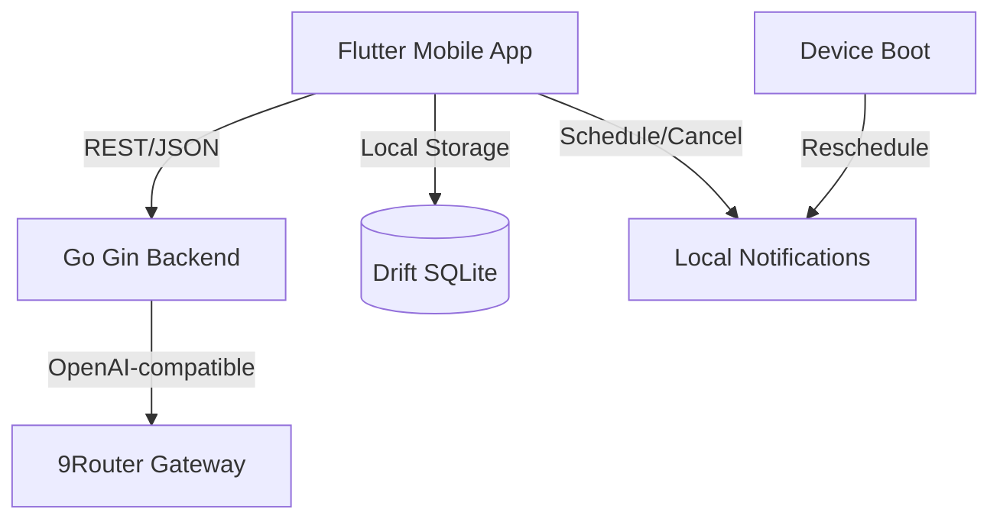

# PRD - LAZY: AI-Powered Personal Productivity Assistant

**Versi**: 1.0  
**Tanggal**: 2025-10-14  
**Status**: Draft - Siap Implementasi  
**Platform**: Android-first (Flutter)  
**Author**: AI-Assisted Development  

---

## 1. Ringkasan Eksekutif

LAZY adalah aplikasi mobile berbasis AI yang dirancang untuk mengurangi gesekan antara niat dan tindakan. Berbeda dengan aplikasi todo konvensional yang menuntut pengguna untuk merencanakan secara detail, LAZY mendorong prinsip "capture first, organize later".

Fokus utama LAZY adalah meminimalkan usaha untuk menangkap pikiran, mengorganisir aktivitas, dan menentukan tugas apa yang sebaiknya dilakukan selanjutnya. Aplikasi ini memanfaatkan AI untuk mengekstrak tugas dari input alami Bahasa Indonesia, namun tetap menempatkan kendali sepenuhnya di tangan pengguna dan tetap berfungsi dengan baik meski AI tidak tersedia (local-first).

---

## 2. Visi Produk & Pernyataan Masalah

### Visi Produk
"Membantu pengguna melakukan lebih banyak hal dengan usaha perencanaan seminimal mungkin."

### Masalah yang Dituju
- Pengguna sering lupa aktivitas yang direncanakan
- Kesulitan memulai tugas karena overwhelmed dengan daftar panjang
- Tidak suka membuat daftar todo yang terstruktur secara manual
- Prokrastinasi akibat kebingungan memilih tugas prioritas
- Butuh waktu lama untuk mencatat ide secara terperinci

### Solusi
LAZY mengatasi masalah ini dengan: quick capture (teks/suara), AI brain dump untuk mengekstrak tugas dari bahasa alami, "Lazy Button" yang merekomendasikan satu tugas paling layak dikerjakan berdasarkan aturan deterministik, dan Thought Inbox untuk ide tanpa deadline.

---

## 3. Tujuan & Bukan Tujuan

### Tujuan (Goals)
- Mengurangi waktu untuk mencatat tugas dari >30 detik menjadi <5 detik
- Memungkinkan pengguna menangkap ide tanpa perlu mengisi form lengkap
- Memberikan satu rekomendasi tindakan yang jelas (one clear primary action)
- Menjaga fungsionalitas core tanpa koneksi internet
- Menyediakan kontrol penuh pengguna atas hasil AI
- Menangani input Bahasa Indonesia dengan natural

### Bukan Tujuan (Non-Goals) - MVP 1.0
- Multi-user atau multi-tenant
- Sinkronisasi lintas perangkat
- Integrasi kalender eksternal (Google Calendar, Outlook)
- Chatbot konversional untuk general purpose
- Gamifikasi (streak, point, badge)
- Fitur kolaborasi
- Analytics kompleks
- Dukungan platform selain Android (iOS postponed)
- Fitur enterprise

---

## 4. Target Pengguna & Persona

### Target Pengguna
- Individu yang sering lupa aktivitas
- Mahasiswa & developer yang mengelola proyek pribadi
- Pengguna yang tidak suka aplikasi todo konvensional
- Pengguna yang lebih memilih input suara dibanding mengetik
- Pengguna yang kesulitan memutuskan tugas mana yang harus dimulai

### User Persona

**Persona 1: "Si Pelupa Sibuk" (Busy Forgetful)**
- Latar belakang: Pekerja/kuliah dengan banyak aktivitas
- Pain point: Sering lupa janji/hal kecil karena terlalu fokus
- Behavior: Butuh capture super cepat saat sedang sibuk

**Persona 2: "Si Overthinker" (Analysis Paralysis)**
- Latar belakang: Sering bingung mana yang dikerjakan dulu
- Pain point: Melihat daftar panjang bikin malah tidak mulai
- Behavior: Butuh rekomendasi tunggal yang actionable

**Persona 3: "Si Idealis" (Brain Dumper)**
- Latar belakang: Sering muncul ide saat jalan/mandi
- Pain point: Ide menguap sebelum sempat dicatat terstruktur
- Behavior: Senang voice note/brain dump

---

## 5. Core User Journeys

1. **Quick Capture**: User lihat Today → tap Quick Capture → input teks/suara → preview → save → kembali ke Today
2. **AI Brain Dump**: User buka Brain Dump → ketik/parafrase ide beruntun dalam Bahasa Indonesia → AI ekstrak multiple tasks → user konfirmasi/edit → save ke Inbox/Task sesuai ada/tidak deadline
3. **Decide Next Action**: User bingung → tekan Lazy Button → dapat 1 rekomendasi → user pilih "Do it" (mark in-progress) atau "Next suggestion"
4. **Manage Energy**: User check-in energy (Low/Med/High) → Lazy Button mempertimbangkan dalam scoring
5. **Convert Idea**: User buka Thought Inbox → pilih ide → convert jadi task dengan deadline/durasi → pindah ke daftar task

---

## 6. Kebutuhan Fitur

| Feature ID | Nama Fitur | Deskripsi | Prioritas | Dependency |
|---|---|---|---|---|
| F01 | Quick Capture | Input cepat teks/suara dari Today screen | Must Have | Local DB |
| F02 | AI Brain Dump | Ekstrak multiple tasks dari bahasa Indonesia natural, support relative dates | Must Have | AI Backend (fallback graceful) |
| F03 | Task Management | CRUD, status (Pending/InProgress/Completed), deadline, durasi, priority | Must Have | Local DB |
| F04 | Today Dashboard | Today's tasks, next recommended, reminders, completed, quick capture | Must Have | F03, F06 |
| F05 | Smart Reminder | Local notification, snooze, missed-task, recovery after restart | Must Have | F03 |
| F06 | Lazy Button | Rekomendasi 1 task deterministik (rule-based), no LLM call | Must Have | F03, F07 |
| F07 | Energy Check-in | Low/Med/High, mempengaruhi scoring rekomendasi | Should Have | F06 |
| F08 | Thought Inbox | Ide tanpa deadline, convert ke scheduled task | Must Have | F03 |

### User Story & Acceptance Criteria (Ringkas)

**F01 Quick Capture**
- US: "Sebagai user, saya ingin mencatat tugas dalam 3 detik tanpa isi form panjang"
- AC: Bisa akses dari Today, preview sebelum save, support voice-to-text, empty input dibatalkan
- Edge: Mic permission denied, speech error → fallback ke teks

**F02 AI Brain Dump**
- US: "Sebagai user, saya ingin mengubah brain dump Bahasa Indonesia jadi daftar task terpisah"
- AC: Ekstrak multiple items, identifikasi tanggal/waktu jika eksplisit, relative dates (hari ini/besok/lusa/minggu depan) berdasarkan timezone lokal user, **tidak menginvent deadline** jika tidak disebut, unclassified → Thought Inbox
- Edge: AI timeout/error → tampil error graceful, retry optional, response malformed → validation fail

**F03 Task Management**
- US: "Sebagai user, saya ingin mengelola status task"
- AC: Status enum Pending/InProgress/Completed, edit/delete, reschedule, priority Low/Med/High
- Edge: Delete task dengan reminder aktif → cancel notification

**F04 Today Dashboard**
- US: "Sebagai user, saya ingin lihat apa yang perlu dilakukan hari ini + rekomendasi jelas"
- AC: Section Today, Next Recommended (Lazy Button result), Upcoming reminders, Completed today, FAB Quick Capture
- Edge: Empty state jelas

**F05 Smart Reminder**
- US: "Sebagai user, saya ingin diingatkan tepat waktu meski offline"
- AC: Local notification, snooze, handle permission, device restart recovery, cancel saat completed/deleted/rescheduled
- Edge: Exact alarm restrictions Android (use appropriate scheduling), doze mode consideration

**F06 Lazy Button**
- US: "Sebagai user, saya ingin 1 rekomendasi aksi, bukan daftar panjang"
- AC: Rule-based deterministic (no LLM), scoring mempertimbangkan urgency, deadline proximity, est duration, energy compatibility, allow "Another suggestion", tampil alasan singkat
- Edge: Semua completed → empty state

**F07 Energy Check-in**
- US: "Sebagai user, saya ingin rekomendasi menyesuaikan energi saat ini"
- AC: Persist current energy level, tidak ubah deadline otomatis
- Edge: Tidak diset → treat sebagai Medium

**F08 Thought Inbox**
- US: "Sebagai user, saya ingin menyimpan ide tanpa deadline untuk diproses nanti"
- AC: Convert ke scheduled task (wajib set deadline/waktu atau tetap simpan sebagai thought? → convert memerlukan minimal jadwal atau bisa assign "unscheduled"? AC: convert membuka form task dengan fields, user tentukan)
- Edge: Convert tanpa input valid → prevent

---

## 7. Kebutuhan Fungsional

### Task Entity Rules
- Task bisa memiliki deadline (opsional). Jika tidak ada → masuk Thought Inbox atau disimpan sebagai unscheduled (non-today)
- Status: `pending | in_progress | completed`
- Priority: `low | medium | high` (default medium)
- Estimated duration menit (opsional)
- Energy affinity opsional (low/med/high) — prefer match dengan current energy
- Prevent duplicate task: title + deadline (date) sama → treat sebagai duplicate, tolak atau merge (konfigurable; MVP: prevent dengan warning)

### AI Brain Dump Rules
- Natural Indonesian, extract multiple tasks dalam 1 input
- Identifikasi: title, date/time, priority (jika eksplisit), context
- **Relative dates**: interpret berdasarkan local date + timezone user (contoh: "besok", "lusa", "hari ini", "minggu depan", "senin depan") — hitung saat processing, bukan hardcode
- **Never invent missing dates/deadlines**: jika tidak disebut eksplisit → item tersebut diklasifikasikan sebagai Thought (unscheduled)
- Structured output contract wajib divalidasi (schema enforcement)
- Graceful degradation: jika AI fail → tampil pesan, user tetap bisa pakai Quick Capture/manual

---

## 8. Kebutuhan Non-Fungsional

| Kategori | Requirement |
|---|---|
| **Platform** | Android-first, minimum Android API level: 24 (Android 7.0) atau sesuai kebutuhan flutter_local_notifications |
| **Local-first** | Core task mgmt, reminders, energy, inbox berfungsi offline |
| **Resilience** | AI optional. Core usable saat backend/LLM unavailable |
| **Privacy** | Semua task/energy/inbox tersimpan lokal (SQLite). Hanya AI Brain Dump yang mengirim teks ke backend. Tidak simpan PII berlebihan |
| **Security** | Backend pegang API key 9Router (tidak di-expose ke mobile). HTTPS untuk backend↔9Router. Validasi input |
| **Performance** | Cold start <2s (target), Lazy Button <10ms (rule-based), DB ops <50ms |
| **Reliability** | Reminder recovery setelah device reboot (reschedule via boot receiver/WorkManager sesuai platform) |
| **UX** | One primary action per screen, minimal input, clear states (empty/loading/error/confirmation) |
| **Indonesian NLP** | Dukungan natural Indonesian untuk brain dump & microcopy |
| **Timezone** | Selalu pakai device timezone untuk interpretasi tanggal relatif |
| **Timeout** | AI request timeout (default 10-15s), configurable, handle network failure |
| **Duplicate Prevention** | Cegah duplikasi berdasarkan (title normalized + date) untuk scheduled task |
| **Offline Error** | Network error → pesan jelas, tidak crash |

---

## 9. MVP Scope & Future Roadmap

### MVP 1.0 (Must Have)
- F01–F06, F08 + F07 (Should Have included in MVP per PRD intent? F07 disebut Should Have tapi berpengaruh ke Lazy Button scoring; keep minimal: energy check-in sederhana)
- Local DB (Drift/SQLite), local notifications, rule-based Lazy Button, AI Brain Dump dengan fallback

### V1.1 (Post-MVP)
- Daily Briefing
- Auto Reschedule suggestions
- Android Home Screen Widget
- Recurring Tasks
- AI Task Breakdown
- Search & Filtering
- Weekly Insights

### V2.0 (Post-MVP)
- Multi-device sync
- Calendar integration
- Backup & restore
- Personalized recommendations
- Optional conversational AI assistant
- Wearable integration

**Constraint**: Post-MVP tidak ditambahkan ke kompleksitas MVP.

---

## 10. Information Architecture

### Navigation (GoRouter)
- `/` → Today Dashboard
- `/capture` → Quick Capture
- `/braindump` → AI Brain Dump (input + confirmation)
- `/task/:id` → Task Detail/Edit
- `/inbox` → Thought Inbox
- `/energy` → Energy Check-in (modal/screen ringan)

### Screen Mapping
| Screen | Purpose | Primary Action |
|---|---|---|
| Today | Overview hari ini + rekomendasi | Quick Capture / Do recommended task |
| Quick Capture | Input super cepat | Save |
| Brain Dump | Input natural → confirm extracted | Confirm & Save / Edit |
| Task Detail | Lihat/edit task | Save / Mark Complete / Delete |
| Thought Inbox | Daftar ide tanpa deadline | Convert to Task / Edit / Delete |
| Energy | Set energi saat ini | Save |

---

## 11. Screen-by-Screen Specifications

### S01 - Today Dashboard
- Header: "Today" + tanggal
- Card "Next Recommended" (Lazy Button): title, reason (1–2 kata), action "Do it" / "Next"
- Section "Today's Activities" (filter deadline == today & not completed)
- Section "Upcoming Reminders" (deadline > now, near)
- Section "Completed Today"
- FAB: + Quick Capture
- Empty states untuk tiap section

### S02 - Quick Capture
- TextField auto-focus, placeholder "Tulis tugas atau ide..."
- Voice button (mic)
- Preview chip: "Save as task?" 
- Actions: Cancel / Save
- Minimize keystrokes

### S03 - AI Brain Dump
- Large text area: placeholder "Ceritain aja semua yang mau kamu lakuin..."
- Hint: "AI bakal ekstrak jadi beberapa tugas. Bisa sebut tanggal/waktu kalau ada"
- Button "Ekstrak dengan AI"
- Confirmation screen: list extracted items (toggle/edit per item: title, date, time, priority). Label "Unscheduled" jika no date
- Actions: Back to edit / Confirm & Save

### S04 - Task Detail/Edit
- Fields: Title, Status, Priority, Deadline (date+time optional), Est duration (min), Notes (optional)
- Actions: Save, Delete, Mark Complete

### S05 - Thought Inbox
- List ide (no deadline), timestamp
- Item: title, "Convert" CTA
- Convert flow: open Task form prefill title, user set deadline/prio
- Empty state

### S06 - Energy Check-in
- Options: Low / Medium / High (visual chips)
- Explain: "Biar rekomendasi lebih pas sama tenaga kamu"
- Persist selection

---

## 12. UX & Design System Guidelines

### Design Direction
Warm Minimalism + Playful Utility. Tenang, ramah, minim cognitive load.

### Color Palette
| Token | Hex | Usage |
|---|---|---|
| `bg` | `#F7F5EF` | Background |
| `text-primary` | `#20211F` | Primary text |
| `accent-yellow` | `#F2D66D` | CTAs, highlights |
| `secondary-sage` | `#A9B9A0` | Subtle elements |
| `neutral` | `#E7E5DF` | Surfaces/dividers |
| `text-secondary` | `#4A4B45` | Secondary text |
| `success` | `#6B8A5A` | Completed |
| `danger` | `#D16B6B` | Delete/warn |

### Typography
- Scale: 12/14/16/18/20/24/28/32
- Weights: 400/500/600/700
- Line height ~1.5–1.7
- Focus readability

### Spacing
- 4pt base: 4,8,12,16,20,24,32,40,48

### Radius
- 12–16px for cards, 999px for buttons

### Principles
- One primary action per screen
- Large tappable targets (>=48x48)
- Generous whitespace
- Clear hierarchy
- Calm microcopy (Bahasa Indonesia)
- Accessible contrast
- Avoid gradients/glassmorphism/excess animation

### States
- Empty, Loading, Error, Success, Confirmation dialog (destructive actions)
- Skeleton minimal jika perlu

---

## 13. High-Level System Architecture

### Overview
```
[Flutter App (Android)]
  ├─ Local: Drift + SQLite (tasks, inbox, energy, reminders)
  ├─ Notifications: flutter_local_notifications
  └─ HTTP: dio/http → [Go Backend (Gin)]

[Go Backend (Gin)]
  ├─ /api/ai/* routes
  ├─ Orchestrator (prompt build + validation)
  ├─ 9Router client (OpenAI-compatible)
  └─ Config (.env) for API key/base URL/model
```

### Mermaid Diagram



### Key Points
- Flutter owns local data + notification scheduling
- Backend only for AI orchestration (brain dump)
- Credentials only on backend
- No direct 9Router call from app
- Core works without backend

---

## 14. Data Models & Database Requirements

### SQLite Entities (Drift)

#### `tasks` table
| Field | Type | Notes |
|---|---|---|
| id | TEXT (UUID) PK | Generated locally |
| title | TEXT NOT NULL | Trimmed |
| description | TEXT | Optional |
| status | TEXT CHECK(in('pending','in_progress','completed')) DEFAULT 'pending' | |
| priority | TEXT CHECK(in('low','medium','high')) DEFAULT 'medium' | |
| deadline_at | INTEGER (unix ms) | Nullable |
| estimated_duration_min | INTEGER | Nullable |
| energy_affinity | TEXT CHECK(in('low','medium','high')) | Nullable |
| created_at | INTEGER NOT NULL | unix ms |
| updated_at | INTEGER NOT NULL | unix ms |
| completed_at | INTEGER | Nullable |

**Indexes**: deadline_at, status, created_at

#### `thought_inbox` table
| Field | Type | Notes |
|---|---|---|
| id | TEXT PK | UUID |
| title | TEXT NOT NULL | |
| content | TEXT | Optional (original brain dump context) |
| created_at | INTEGER NOT NULL | |
| converted | INTEGER DEFAULT 0 (bool) | |
| converted_to_task_id | TEXT FK -> tasks(id) | Nullable |

#### `energy_state` table (single-row)
| Field | Type | Notes |
|---|---|---|
| id | INTEGER PK (1) | Singleton |
| level | TEXT CHECK(in('low','medium','high')) DEFAULT 'medium' | |
| updated_at | INTEGER NOT NULL | |

#### `reminders` table (tracking)
| Field | Type | Notes |
|---|---|---|
| id | TEXT PK | UUID |
| task_id | TEXT FK -> tasks(id) ON DELETE CASCADE | |
| notification_id | INTEGER | Platform notification id |
| scheduled_at | INTEGER NOT NULL | unix ms |
| status | TEXT CHECK(in('scheduled','fired','cancelled','snoozed')) DEFAULT 'scheduled' | |
| snooze_count | INTEGER DEFAULT 0 | |

**Constraints**: No over-normalization. Keep minimal for MVP.

**Duplicate prevention**: Before insert scheduled task, check exists (LOWER(TRIM(title)) == candidate AND DATE(deadline_at, tz)=DATE(candidate,tz))? Or compare day precision. Implement as helper in repo layer.

---

## 15. Backend API Requirements

Base URL: `http://<host>:<port>/api` (local dev; prod TBD). All JSON. Auth not required for MVP single-user (localhost binding or reverse proxy). 

### Endpoints

#### POST `/ai/brain-dump/extract`
Extract tasks from brain dump text.

**Request:**
```json
{
  "text": "string (min 3 chars)",
  "timezone": "string (IANA, e.g. Asia/Jakarta)",
  "now": "string (ISO8601 UTC or local? prefer ISO8601 with offset or epoch ms) — or just rely server uses provided now"
}
```
But better: send `nowIso` or let backend use server time + timezone? To match user local context, pass `timezone` and `nowMs` (epoch ms from device).

**Recommended:**
```json
{
  "text": "string",
  "timezone": "Asia/Jakarta",
  "nowMs": 1728900000000
}
```

**Response (200):**
```json
{
  "items": [
    {
      "title": "string",
      "suggestedDate": "YYYY-MM-DD | null",
      "suggestedTime": "HH:MM | null",
      "priority": "low|medium|high|null",
      "reason": "string|null"
    }
  ]
}
```

**Errors:** 400 (validation), 408 (timeout), 502/503 (provider error), 422 (validation schema fail)

#### GET `/healthz`
```json
{ "status": "ok" }
```

**Notes:**
- Backend validates structured output strictly (see 16)
- Do not log full user text in prod; truncate
- Idempotent? POST not idempotent by design

---

## 16. AI Integration & Prompt Processing Flow

### Gateway
- 9Router, OpenAI-compatible API
- Endpoint configurable via env: `AI_BASE_URL`, `AI_API_KEY`, `AI_MODEL`, `AI_TIMEOUT_SEC`
- Backend managed credentials (never in app)

### Structured Output Contract
Strict JSON schema for extraction:

```json
{
  "type": "object",
  "required": ["items"],
  "properties": {
    "items": {
      "type": "array",
      "items": {
        "type": "object",
        "required": ["title"],
        "properties": {
          "title": {"type": "string", "minLength": 1},
          "suggestedDate": {"type": ["string","null"], "pattern": "^\\d{4}-\\d{2}-\\d{2}$"},
          "suggestedTime": {"type": ["string","null"], "pattern": "^([01]\\d|2[0-3]):[0-5]\\d$"},
          "priority": {"type": ["string","null"], "enum": ["low","medium","high"]},
          "reason": {"type": ["string","null"]}
        }
      }
    }
  }
}
```

**Validation requirements:**
- Parse JSON only (no markdown fence)
- Validate against schema
- Sanitize strings (trim, length limit)
- `suggestedDate` must be valid calendar date (not 2025-02-30)
- If date/time present together or alone, respect; if neither → treat as unscheduled (Thought)
- **Never coerce missing date**: validation passes even if null
- Max items? reasonable limit (e.g. 20) to avoid abuse
- Title length 1–100 chars

### Prompt Guidelines
- Bahasa Indonesia primary
- Instruct: "Jangan menciptakan tanggal/deadline jika tidak disebutkan secara eksplisit"
- Instruct: "Pisahkan ide menjadi tugas terpisah yang actionable"
- Provide `timezone` + `now` (formatted YYYY-MM-DD HH:MM)
- Emphasize relative terms: hari ini/besok/lusa/minggu depan, nama hari (senin-rabu) → compute relative to now+tz
- Output ONLY JSON sesuai schema
- Handle ambiguity: if vague → unscheduled

### Processing Flow
1. Client POST `/ai/brain-dump/extract` with text, timezone, nowMs
2. Backend validate request (min length, valid tz)
3. Build prompt + context (now in tz)
4. Call 9Router with timeout + retry? MVP: single attempt with timeout
5. Parse + validate schema
6. Return validated items (or 422 with details)
7. Client shows confirmation UI; user may edit before save

### Error Handling
- Timeout → 408 "Request timeout"
- Provider 5xx → 502 "AI provider unavailable"
- Invalid JSON/schema → 422 "Invalid structured output"
- Network error → 503
- Client-side: on error, allow retry or fall back to manual Quick Capture

---

## 17. Notification & Background Execution Strategy

### Local Notifications (flutter_local_notifications)
- Schedule exact/alarm as appropriate per Android version (API 24+). Use `androidScheduleMode`/inexact where needed
- For tasks with `deadline_at`, schedule reminder (e.g. at deadline or X min before? MVP: at deadline time if time set, or end-of-day? define: if has time → schedule at that time; if date only → optional? suggest "remind at 09:00"? Keep simple: schedule at `deadline_at` if set)
- Snooze: reschedule + (e.g.) 10 min
- On task completed/deleted/rescheduled → cancel notification
- On snoozed → update reminders table

### Device Restart Recovery
- Android: register `BOOT_COMPLETED` receiver
- On boot: query scheduled pending tasks with future deadline_at → reschedule notifications
- Also handle app upgrade? minimal

### Background Constraints
- Avoid long-running bg tasks. Use WorkManager for reschedule on boot/retry minimal
- Do not rely on Firebase Cloud Messaging (FCM) for MVP (local-first)

---

## 18. Offline & Error Handling Strategy

### Offline Scenarios
- Quick Capture: works (save to SQLite)
- Task CRUD: works
- Lazy Button: works (rule-based)
- Energy: works
- Thought Inbox: works
- AI Brain Dump: fails gracefully → show "Tidak bisa terhubung ke AI. Coba lagi nanti atau gunakan Quick Capture"
- Reminders: fire locally even offline

### Network Failures
- Detect connectivity? minimal (catch DioException)
- Show non-blocking error
- No auto-retry spam

### API Timeouts
- Configurable (default 10–15s)
- User can cancel? optional

### Data Integrity
- DB transactions for multi-step (e.g. convert inbox→task)
- Foreign keys ON DELETE CASCADE for reminders
- Validation at UI + repo layer
- Trim all text inputs

### Edge Cases
- Empty AI result → "AI tidak menemukan tugas. Coba ubah kalimat kamu"
- All tasks completed → Lazy Button empty state
- Mic permission denied → fallback text
- Speech recognition not available → fallback text
- Duplicate task → warn "Task serupa sudah ada (judul + tanggal sama). Tetap simpan?" (MVP: simple check, confirm)
- Deadline in past → warn but allow? user might want to log; MVP: allow with visual hint
- Timezone change? rare; use current tz at render

---

## 19. Security & Privacy Requirements

| Req | Detail |
|---|---|
| **Local-first data** | Tasks/inbox/energy/reminders hanya di device (SQLite) |
| **API key protection** | Disimpan di backend env (.env), never bundled in APK |
| **Minimal data send** | Hanya field `text`, `timezone`, `nowMs` dikirim ke AI |
| **No PII logging** | Backend log request metadata (status/latency) tanpa full text; truncate jika perlu debug |
| **HTTPS** | Wajib untuk backend↔9Router (production). Dev boleh http |
| **Input validation** | Server-side validation request + schema |
| **Network binding** | Dev: localhost/lan? single-user; avoid 0.0.0.0 public unless auth added |
| **Android permissions** | POST_NOTIFICATIONS (Android 13+), RECORD_AUDIO (optional for voice) — request on demand |
| **No 3rd-party trackers** | None for MVP |
| **Data export?** | Post-MVP (V2.0) — not MVP |

---

## 20. Testing & Quality Assurance Strategy

### Levels
- Unit: scoring logic Lazy Button, date parser (relative dates), validators
- Widget: Today screen, Quick Capture, confirmation list
- Integration: DB CRUD, repo, notification scheduling (mock)
- Contract: AI schema validation
- Manual E2E: core flows

### Key Test Cases
- Brain dump: "besok meeting jam 10" → suggestedDate = tomorrow, suggestedTime 10:00
- Brain dump: "kerja project" → unscheduled (null dates)
- Brain dump: mixed (scheduled + unscheduled)
- Relative: "lusa", "minggu depan", "senin depan"
- Duplicate detection
- Lazy Button: tie-breakers (deadline closer wins)
- Energy match boosts score
- Boot recovery reschedules
- Snooze works
- Offline AI fallback
- Permission flows

### Tools
- Flutter: flutter_test, integration_test, mocktail
- Go: testing, httptest

---

## 21. Performance & Reliability Requirements

| Metric | Target | Notes |
|---|---|---|
| Cold start | < 2.0s | Flutter app |
| Lazy Button calc | < 10ms | Deterministic, small dataset |
| DB read/write | < 50ms | Local SQLite |
| AI timeout | 10–15s | Configurable |
| Reminder precision | Best effort | Respect Android doze/exact alarms |
| Memory | Minimal | Small lists |
| Crash-free | >= 99% | Core flows stable |

---

## 22. Development Milestones

| Milestone | Scope | Est (days) | Acceptance |
|---|---|---|---|
| M0 - Setup | Repo, Flutter + Go scaffold, env, lint | 0.5 | Builds pass |
| M1 - Data Layer | Drift models, migrations, repos, DAOs | 1 | CRUD tests pass |
| M2 - Core Tasks + UI | Task list/detail, Today base, CRUD | 1–1.5 | Create/edit/complete works |
| M3 - Quick Capture + Inbox | F01, F08, navigation | 0.5 | Fast capture works |
| M4 - Lazy Button | F06 deterministic scoring, energy read | 0.5 | Reproducible, explain reason |
| M5 - Energy Check-in | F07 | 0.25 | Persists, affects score |
| M6 - Notifications | F05 schedule/cancel/snooze/boot recovery | 1 | Fires, recovers after reboot |
| M7 - Go Backend + AI | /ai/brain-dump/extract, 9Router, schema validation | 1 | Contract tests pass |
| M8 - Brain Dump UI | F02 confirm/edit, fallback | 0.5 | Mixed items handled |
| M9 - Polish & QA | Empty/loading/error, dup check, perf, bugfix | 0.5–1 | DoD satisfied |
| **Total** | | **~7–8 days** | |

---

## 23. Risks, Constraints & Mitigations

| Risk | Impact | Likelihood | Mitigation |
|---|---|---|---|
| Android alarm/doze limits | Med | Med | Use appropriate schedule mode, test on API levels, document behavior |
| 9Router downtime | Low (core usable) | Med | Graceful fallback, clear message, retry later |
| Over-engineering AI | Med | Low | Strict schema, rule-based Lazy Button, never LLM for recs |
| Timezone/relative date bugs | Med | Med | Centralize date calc (pure func), unit tests with fixed now |
| Duplicate noise | Low | Med | Normalized title + date check + confirm dialog |
| Speech API varies | Low | Low | Fallback to text, handle errors |
| Notification permission (Android 13+) | Med | Med | Request on demand, explain rationale |

---

## 24. MVP Definition of Done (DoD)

- [ ] Semua F01–F06,F08 berfungsi sesuai AC (F07 minimal OK)
- [ ] Core berfungsi 100% offline (kecuali AI Brain Dump saat dipanggil)
- [ ] AI Brain Dump: validasi schema ketat, never invent deadline
- [ ] Unscheduled → Thought Inbox; scheduled → tasks
- [ ] Lazy Button deterministik, explain reason singkat
- [ ] Reminder: schedule/cancel/snooze + boot recovery
- [ ] Permission handling (notification/audio)
- [ ] Duplicate prevention terimplementasi
- [ ] Error states/loading/empty jelas (Bahasa Indonesia)
- [ ] Unit tests: scoring, relative date parser, validators
- [ ] Tidak ada credentials di mobile
- [ ] Build Android berhasil (debug/release minimal)
- [ ] Tidak ada fitur V1.1/V2.0 yang di-implement
- [ ] Code clean, no dead code, sesuai prinsip ponytail/lazy

---

## 25. Success Metrics

| Metric | Baseline | Target (MVP) | Sumber |
|---|---|---|---|
| Time to capture task | ~30s | < 5s | Manual test (Quick Capture) |
| % capture without form fill | 0% | > 80% | Usage behavior |
| AI extraction usable (accepted as-is) | — | >= 70% | User confirmations |
| Core offline success | — | 100% | Manual test |
| Reminder delivery reliability | — | >= 95% | Boot + schedule tests |
| Tasks started via Lazy Button | — | >= 40% | Local telemetry (optional, MVP: track counts locally) |

---

## Catatan Implementasi (Guidance)

- **Relative date parsing**: implement pure function `parseRelativeDate(text, now, tz)` — testable
- **Scoring (Lazy Button)**: weighted deterministic. Factors: deadline proximity (urgency), is due today/tomorrow, est duration fit energy, priority, idle age? simple: urgency + priority + energy match + age (created_at). Document weights
- **Backend config**: `.env.example` wajib (AI_BASE_URL, AI_API_KEY, AI_MODEL, AI_TIMEOUT_SEC, PORT)
- **Drift**: generate code, keep migrations minimal
- **Go**: thin layer, validator strict, slog for logs
- **Bahasa Indonesia**: konsisten di UI

---

**End of PRD. Dokumen ini adalah single source of truth untuk implementasi AI-assisted. Tidak untuk generate source code saat ini — hanya perencanaan.**
